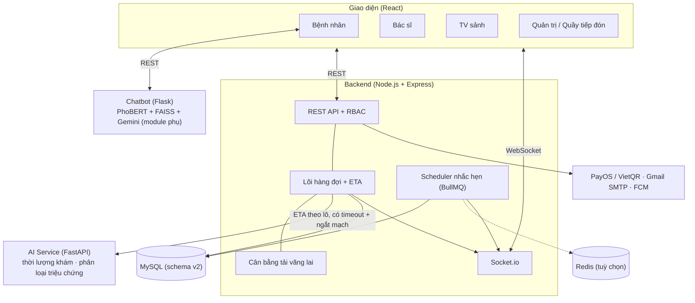

# Hệ thống đặt lịch khám bệnh và quản lý hàng đợi tích hợp AI

Đồ án tốt nghiệp (VKU – Khoa Khoa học Máy tính, ngành Công nghệ phần mềm): hệ thống **liên thông đặt lịch khám với hàng đợi thời gian thực**, dự đoán thời gian chờ bằng Machine Learning, gợi ý chuyên khoa từ triệu chứng, nhắc hẹn và cân bằng tải phòng khám.

*Developing an AI-Integrated Appointment Scheduling and Patient Queue Management System.*
Nhóm thực hiện: Trần Xuân Đức (backend, CSDL, AI) · Ngô Thị Mỹ Lành (frontend, UI/UX). Giảng viên hướng dẫn: TS. Nguyễn Thanh Tuấn.

> Hệ thống phát triển từ một ứng dụng đặt lịch kiểu BookingCare (đặt lịch, thanh toán, chat, chatbot tư vấn) rồi được nâng cấp thành hệ thống hàng đợi thông minh theo đề cương. **Số liệu thật và những chỗ khác đề cương** xem [docs/DIEU_CHINH_SO_VOI_DE_CUONG.md](docs/DIEU_CHINH_SO_VOI_DE_CUONG.md).

## Hệ thống làm được gì

- **Đặt lịch an toàn:** chọn bác sĩ/khung giờ, giữ chỗ có hạn đến khi xác nhận qua email, chặn đặt trùng khi nhiều người đặt cùng lúc.
- **Hàng đợi thực:** check-in, cấp số thứ tự (không trùng), gọi số, bấm giờ ca khám, ưu tiên khẩn cấp/cao tuổi/trẻ nhỏ, dời lượt, vắng mặt; phát sự kiện realtime cho bệnh nhân, bác sĩ và TV sảnh.
- **ETA bằng ML:** thời gian chờ = phần còn lại của ca đang khám + tổng thời lượng dự kiến của những người đứng trước; có dự phòng khi AI lỗi (trung bình lịch sử → mặc định 15 phút).
- **Bệnh nhân vãng lai:** đăng ký tại quầy, hệ thống tự chọn bác sĩ đang trực có thời gian chờ ngắn nhất.
- **Nhắc hẹn:** trước 24h và 2h; cảnh báo khi sắp đến lượt; API thông báo + realtime cho chuông thông báo.
- **Gợi ý chuyên khoa:** từ triệu chứng tiếng Việt, kèm luật cấp cứu chạy trước mô hình.
- **Phân quyền chi tiết (RBAC theo permission):** cấu hình trong DB, default-deny, nhật ký audit.
- **Tính năng sẵn có từ trước:** hồ sơ bệnh án + đơn thuốc PDF qua email, thanh toán PayOS/VietQR, chat bác sĩ–bệnh nhân, cẩm nang, gói khám, chatbot tư vấn (RAG + Gemini).

## Trạng thái (27/11/2026)

| Phần | Tình trạng |
|---|---|
| Backend: xác thực/RBAC, schema v2, đặt lịch, lõi hàng đợi, tích hợp AI | Xong |
| Backend: nhắc hẹn, cân bằng tải vãng lai, API thông báo | Xong (Pull Request, chờ merge) |
| AI Service (3 mô hình + API) | Xong |
| Frontend: e-Ticket QR, Live Queue Tracker, Cổng bác sĩ, TV sảnh + đọc loa, quản lý phòng, quản trị RBAC, Heatmap | **Chưa làm** (đang thực hiện) |
| Cân bằng tải: chuyển vé vãng lai giữa các phòng, tự đánh vắng mặt | Xong |
| Docker compose chạy cả hệ thống 1 lệnh | Xong (xem [Chạy bằng Docker](#chạy-bằng-docker)) |
| Đo độ trễ/chịu tải | Xong (`backend/LOAD_TEST.md`) |

> **Về dữ liệu ML (nói thật):** dataset Kaggle (10.000 dòng) có dấu hiệu tổng hợp; mục tiêu đề cương MAE ≤ 2.5 phút và R² ≥ 0.85 **không đạt được hợp lệ**. Kết quả thật: giảm 39.7% sai số thời gian chờ so với đoán trung bình; mô hình thời lượng khám (huấn luyện trên **dữ liệu mô phỏng**) giảm 65.7% sai số ETA so với "cố định 15 phút". Chi tiết ở [ai-service/README.md](ai-service/README.md).

## Kiến trúc



Chatbot tư vấn là **module phụ** (có dùng Gemini); các module cốt lõi (hàng đợi, ETA, phân loại triệu chứng) không gọi API AI bên ngoài. Tắt chatbot hoặc AI Service thì đặt lịch và hàng đợi vẫn chạy bình thường.

## Cấu trúc thư mục

> `backend`, `frontend`, `chatbot` là **git submodule** (repo riêng); `ai-service` và `docs` nằm trực tiếp trong repo này. Clone: `git clone --recurse-submodules <url>`.

```text
medical-appointment-system/
├── backend/        # Node.js + Express + Sequelize + Socket.io (submodule)
│   ├── src/        #   config · controllers · middleware · models · services (queue, ai) · socket · migrations
│   ├── QUEUE_ENGINE.md      # lõi hàng đợi, API, cân bằng tải
│   ├── AI_INTEGRATION.md    # cách backend dùng AI Service
│   └── REMINDERS.md         # nhắc hẹn + API thông báo
├── frontend/       # React SPA (submodule)
├── chatbot/        # Flask: PhoBERT + FAISS + Gemini (submodule)
├── ai-service/     # FastAPI: dự đoán thời lượng khám, phân loại triệu chứng, báo cáo ML (xem README riêng)
└── docs/           # tài liệu thiết kế (xem bảng dưới)
```

## Chạy bằng Docker

Cần Docker Desktop (hoặc Docker Engine + Compose v2). **Một lệnh** dựng MySQL, Redis, AI Service, API và giao diện:

```bash
git clone --recurse-submodules <url-repo> && cd medical-appointment-system
docker compose up --build
```

Lần đầu build mất vài phút (tải ảnh nền, cài thư viện, build React; máy dev đo được ~20 phút khi mạng chậm). Từ lần sau chỉ vài giây. Khi log API hiện `Nhắc hẹn đã bật`, hệ thống đã sẵn sàng:

| Địa chỉ | Dịch vụ |
|---|---|
| http://localhost:3000 | Giao diện (React + nginx) |
| http://localhost:6969 | API + Socket.io |
| `127.0.0.1:3307` | MySQL (user `clinic`, root `demo_root_pw`) để xem dữ liệu bằng DBeaver/Workbench |
| nội bộ `ai:8001`, `redis:6379` | AI Service, Redis (không mở ra ngoài) |

**Tài khoản demo** (mật khẩu chung `Demo@12345`, đổi bằng `DEMO_PASSWORD`). Dữ liệu demo được nạp tự động mỗi lần khởi động (chạy lại không nhân đôi, lịch khám luôn tính từ hôm nay):

| Email | Vai trò |
|---|---|
| `admin@demo.local` | Quản trị (R1) |
| `bacsi1@demo.local` (Nội), `bacsi2@demo.local` (Tim mạch), `bacsi3@demo.local` (Nhi) | Bác sĩ (R2) |
| `benhnhan1@demo.local`, `benhnhan2@demo.local` (cao tuổi, thử ưu tiên) | Bệnh nhân (R3). Mỗi người có sẵn 1 lịch hẹn đã xác nhận hôm nay để check-in ngay |
| `thungan@demo.local` | Thu ngân (R4) |
| `letan@demo.local` | Lễ tân (R5) |
| `yta@demo.local` | Y tá (R6) |
| `dieuphoi@demo.local` | Điều phối viên (R7), xem heatmap/chuyển vé |
| `tv@demo.local` | Màn hình sảnh chờ (R8) |

Thử nhanh luồng hàng đợi: `benhnhan1` check-in lịch hẹn (`POST /api/queue/check-in`) → `bacsi1` gọi số (`POST /api/queue/doctor/call-next`) → TV/bệnh nhân nhận sự kiện realtime.

**Cấu hình:** mặc định chạy được ngay bằng bí mật DEMO. Muốn đổi cổng, mật khẩu, JWT, bật email/PayOS: `cp .env.example .env` rồi sửa (Compose tự đọc). Lệnh hữu ích:

```bash
docker compose logs -f api         # xem log API
docker compose down                # dừng (giữ dữ liệu)
docker compose down -v             # dừng và XOÁ dữ liệu (DB, ảnh tải lên)
SEED_DEMO=false docker compose up  # không nạp dữ liệu demo
```

> **Lưu ý:** cấu hình mặc định chỉ để demo/dev (`NODE_ENV=demo`: cookie không bắt buộc HTTPS, CORS mở cho localhost/LAN, bí mật công khai trong file). Triển khai thật phải đặt `APP_ENV=production`, `JWT_*`/mật khẩu DB riêng, `WEB_URL`/`PUBLIC_API_URL` theo tên miền HTTPS. Chatbot (RAG + Gemini) **chưa nằm trong Compose** vì cần mô hình lớn và khoá Gemini; chạy riêng theo mục dưới. Địa chỉ API được nhúng vào giao diện lúc build (`PUBLIC_API_URL`), đổi địa chỉ thì build lại `web`.

## Chạy thủ công (không Docker)

Cần: Node.js 22, MySQL 8, Python 3.10 (AI Service). Redis **không bắt buộc** (không có Redis, cache dùng bộ nhớ và nhắc hẹn chạy bằng `setInterval`).

**1. Backend** (cổng mặc định `6969`)
```bash
cd backend
cp .env.example .env        # điền DB_*, JWT_SECRET, JWT_REFRESH_SECRET (khác nhau, >= 32 ký tự)...
npm install
npm run db:create           # tạo DB
npm run db:migrate          # schema v2
npm run db:seed             # danh mục tham chiếu
npm run dev
```
Biến tuỳ chọn trong `.env`: `AI_SERVICE_URL` (để trống = tắt AI, ETA dùng trung bình lịch sử), `REDIS_*`, `REMINDERS_ENABLED`, `EMAIL_APP*`, `PAYOS_*`, `FIREBASE_*`.

**2. AI Service** (cổng `8001`) — mô hình đã huấn luyện có sẵn trong `ai-service/models/`, chỉ cần chạy `serve`:
```powershell
cd ai-service
py -3.10 -m venv .venv ; .venv\Scripts\pip install -r requirements.txt
$env:PYTHONPATH = "src" ; python -m ai_service serve
```
Rồi đặt `AI_SERVICE_URL=http://127.0.0.1:8001` trong `.env` của backend.

**3. Frontend** (cổng `3000`): `cd frontend && npm install && npm start` (đặt `REACT_APP_BACKEND_URL` trỏ tới backend).

**4. Chatbot** (cổng `5002`, tuỳ chọn): `cd chatbot && pip install -r requirements.txt && python main.py`.

**Kiểm thử**
```bash
cd backend && npm test                      # test thuần (không cần DB)
RUN_DB_TESTS=1 npm test                     # thêm test trên MySQL thật (hàng đợi, đồng thời, phân quyền, nhắc hẹn...)
cd ai-service && python -m pytest           # 107 test
```
Test DB dùng đúng CSDL trong `.env`: tạo dữ liệu tạm rồi tự dọn, chạy **tuần tự** (đã cấu hình). Nên trỏ `.env` tới DB thử nghiệm, không phải DB đang có dữ liệu thật.

## Tài liệu

| Tài liệu | Nội dung | Còn hiệu lực? |
|---|---|---|
| [docs/DIEU_CHINH_SO_VOI_DE_CUONG.md](docs/DIEU_CHINH_SO_VOI_DE_CUONG.md) | Chỗ khác đề cương, số liệu ML thật, trạng thái từng hạng mục | ✅ nguồn chính |
| [docs/database_schema_v2.md](docs/database_schema_v2.md) | Thiết kế CSDL chuẩn (schema v2) | ✅ |
| [backend/QUEUE_ENGINE.md](backend/QUEUE_ENGINE.md) · [AI_INTEGRATION.md](backend/AI_INTEGRATION.md) · [REMINDERS.md](backend/REMINDERS.md) | Hàng đợi, tích hợp AI, nhắc hẹn/thông báo | ✅ |
| [ai-service/README.md](ai-service/README.md) | Mô hình, quy trình ML, báo cáo | ✅ |
| [docs/chatbot_evaluation_and_upgrade_plan.md](docs/chatbot_evaluation_and_upgrade_plan.md) | Đánh giá và kế hoạch nâng cấp **chatbot** | ✅ trong phạm vi chatbot |
| [docs/workflows.md](docs/workflows.md) · [activity_diagrams.md](docs/activity_diagrams.md) · [sequence_diagrams.md](docs/sequence_diagrams.md) · [usecase_diagram.md](docs/usecase_diagram.md) · [class_diagram.md](docs/class_diagram.md) | Sơ đồ luồng/UML của hệ thống đặt lịch **trước khi có hàng đợi, AI và schema v2** | ⚠️ một phần lỗi thời |
| [docs/database_schema.md](docs/database_schema.md) | Schema **cũ** (v1) | ❌ lỗi thời, thay bằng `database_schema_v2.md` |
