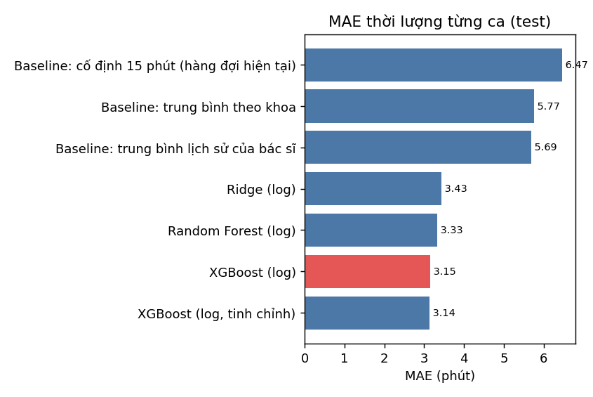
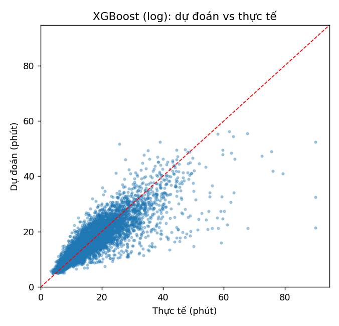
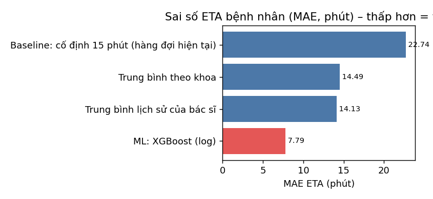
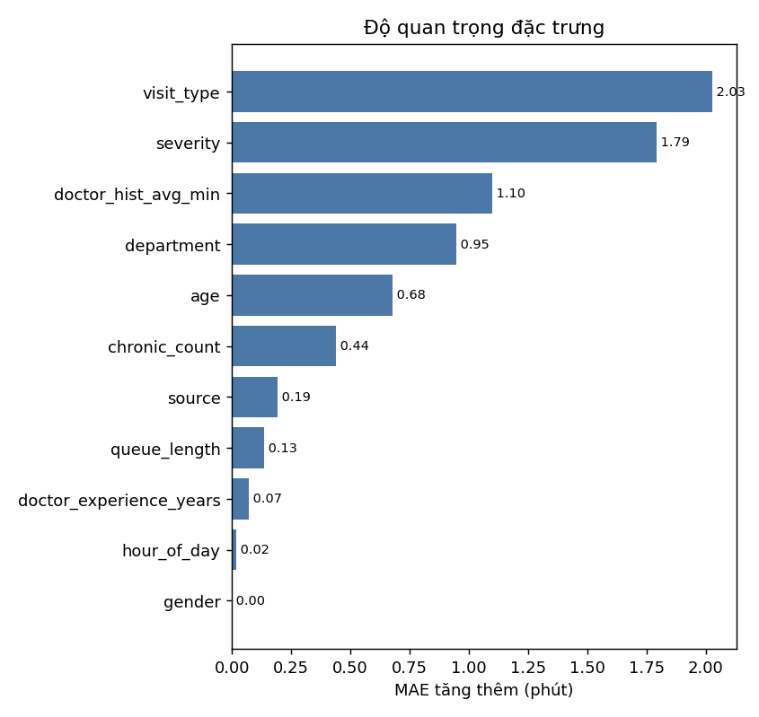

# Báo cáo: mô hình thời lượng khám (tích hợp vào hàng đợi)

> Sinh tự động bởi `python -m ai_service train-duration` – phiên bản `20261112-1d315e5e`, nguồn dữ liệu **synthetic**, hạt giống 42.

> ⚠️ **Dữ liệu MÔ PHỎNG.** Các con số dưới đây phản ánh khả năng mô hình học lại các giả định của bộ mô phỏng (có nhiễu và đặc trưng nhiễu),
> **không phải** kết quả trên bệnh viện thật. Mục đích: chứng minh quy trình, và cho thấy ETA cải thiện thế nào *nếu* thời lượng phụ thuộc các yếu tố này.
> Khi hệ thống chạy thật, tái huấn luyện bằng `python -m ai_service export-real` rồi `train-duration --source real`.

### Giả định của bộ mô phỏng
| Yếu tố | Giả định |
|---|---|
| Thời lượng nền theo khoa (phút) | Cơ xương khớp 14, Thần kinh 22, Tiêu hóa 15, Tim mạch 18, Tai mũi họng 10, Cột sống 16, Hô hấp - Phổi 14, Nha khoa 20 |
| Mức nặng | MILD ×0.82, MODERATE ×1.0, SEVERE ×1.4 |
| Loại khám | NEW ×1.0, FOLLOW_UP ×0.65 |
| Nguồn | BOOKED ×1.0, WALK_IN ×1.12 |
| Tuổi | child(≤6) ×1.15, adult ×1.0, elderly(≥65) ×1.25 |
| Bệnh nền | mỗi bệnh +8% |
| Kinh nghiệm bác sĩ | 1.12 − 0.006·min(năm, 30) |
| Mệt mỏi trong buổi | +1.2% mỗi giờ |
| Áp lực hàng đợi | hàng đợi > 4 người: nhanh thêm 1.5%/người, tối đa nhanh 15% |
| Tốc độ riêng từng bác sĩ | lognormal σ=0.08 |
| Nhiễu từng ca | lognormal σ=0.2; 3% ca phức tạp nhân 1.6–2.4 |
| Giới hạn | 3–90 phút |

## 1. Cách làm
- 29,874 ca khám trong 3,000 buổi khám; chia **theo buổi khám** (train 23,889 ca / test 5,985 ca) để không rò rỉ.
- Đặc trưng (đều biết lúc check-in): department, gender, severity, visit_type, source, age, chronic_count, doctor_experience_years, hour_of_day, queue_length, doctor_hist_avg_min.
- Huấn luyện trên log(thời lượng) vì thời lượng lệch phải và nhiễu nhân tính; đổi ngược về phút khi dự đoán.
- Chọn mô hình bằng kiểm định chéo 5-fold theo nhóm; chọn **mô hình đơn giản nhất trong ngưỡng 1% MAE**. Kết quả: **XGBoost (log)**.

## 2. Kết quả từng ca (tập test)

| Mô hình | MAE (phút) | RMSE | R² | MedAE | Sai số P90 |
|---|---|---|---|---|---|
| Baseline: cố định 15 phút (hàng đợi hiện tại) | 6.474 | 9.29 | -0.0817 | 4.77 | 13.63 |
| Baseline: trung bình theo khoa | 5.768 | 8.034 | 0.191 | 4.483 | 11.382 |
| Baseline: trung bình lịch sử của bác sĩ | 5.691 | 8.064 | 0.185 | 4.3 | 11.888 |
| Ridge (log) | 3.432 | 5.36 | 0.6399 | 2.358 | 7.211 |
| Random Forest (log) | 3.327 | 5.22 | 0.6585 | 2.263 | 7.051 |
| XGBoost (log) | 3.146 | 5.023 | 0.6838 | 2.102 | 6.547 |
| XGBoost (log, tinh chỉnh) | 3.136 | 5.013 | 0.6851 | 2.113 | 6.533 |

MAE của mô hình được chọn: **3.146 phút** (95% CI 3.05 – 3.25), R² **0.6838**. MAE theo mức nặng — MILD: 2.72, MODERATE: 3.13, SEVERE: 4.34. Theo khoa — Cơ xương khớp: 2.72, Thần kinh: 4.1, Tiêu hóa: 2.76, Tim mạch: 4.0, Tai mũi họng: 1.98, Cột sống: 3.23, Hô hấp - Phổi: 2.86, Nha khoa: 3.74.

**Khoảng dự đoán p10–p90:** độ phủ thực tế trên test **80.4%** (danh định 80%).

### Kiểm định chéo 5-fold theo nhóm (MAE trên train)

| Mô hình | MAE | Độ lệch |
|---|---|---|
| Baseline: cố định 15 phút (hàng đợi hiện tại) | 6.262 | ± 0.061 |
| Baseline: trung bình theo khoa | 5.676 | ± 0.057 |
| Baseline: trung bình lịch sử của bác sĩ | 5.539 | ± 0.064 |
| Ridge (log) | 3.390 | ± 0.035 |
| Random Forest (log) | 3.305 | ± 0.048 |
| XGBoost (log) | 3.137 | ± 0.042 |
| XGBoost (log, tinh chỉnh) | 3.126 |  |

## 3. Giá trị ở mức hệ thống: sai số ETA của bệnh nhân
Chờ(Pₙ) = Σ thời lượng những người đứng trước. So sánh cách ước tính thời lượng từng ca (mô phỏng trên các buổi khám của tập test):

| Cách ước tính | MAE ETA (phút) | P90 | Sai ≤ 10 phút | vị trí 2–4 | vị trí 5–8 | vị trí ≥9 | So với cố định 15' |
|---|---|---|---|---|---|---|---|
| Baseline: cố định 15 phút (hàng đợi hiện tại) | 22.74 | 54.5 | 38% | 9.93 | 23.28 | 38.4 | 0.0% |
| Trung bình theo khoa | 14.49 | 33.29 | 49% | 8.27 | 15.21 | 21.4 | 36.3% |
| Trung bình lịch sử của bác sĩ | 14.13 | 32.78 | 51% | 7.78 | 14.66 | 21.5 | 37.9% |
| ML: XGBoost (log) | 7.79 | 17.98 | 74% | 4.33 | 8.23 | 11.55 | 65.7% |

**Kết luận:** dùng mô hình thay cho "cố định 15 phút" giảm sai số ETA **65.7%** (MAE 22.74 → 7.79 phút). Sai số tích luỹ càng lớn khi bệnh nhân đứng càng sau, nên lợi ích càng rõ ở cuối hàng.

### Độ quan trọng đặc trưng (hoán vị)
| Đặc trưng | MAE tăng thêm (phút) |
|---|---|
| visit_type | 2.028 |
| severity | 1.792 |
| doctor_hist_avg_min | 1.097 |
| department | 0.946 |
| age | 0.679 |
| chronic_count | 0.44 |
| source | 0.193 |
| queue_length | 0.134 |
| doctor_experience_years | 0.072 |
| hour_of_day | 0.019 |

