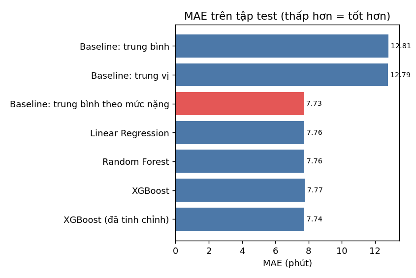
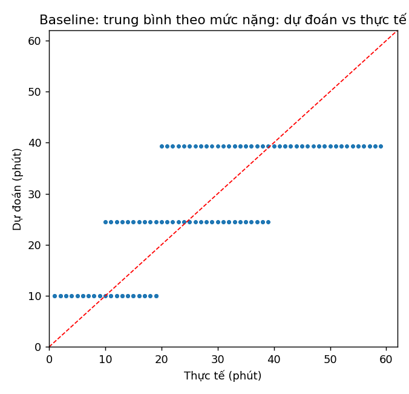
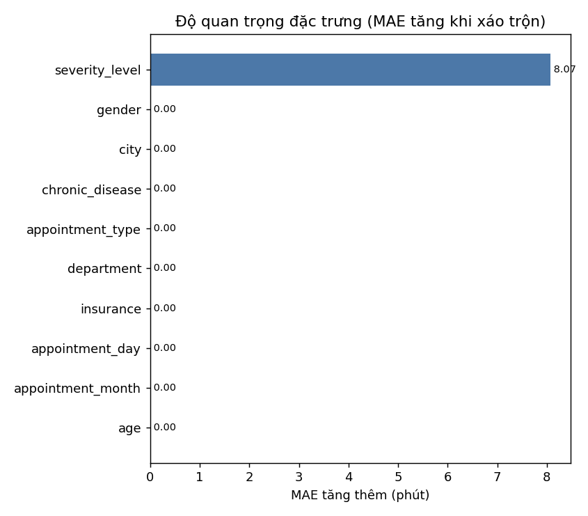

# Báo cáo: dự đoán thời gian chờ trên dataset Kaggle

> Sinh tự động bởi `python -m ai_service train-wait` – phiên bản mô hình `20261112-5bfdcc58`, dữ liệu sha256 `8d9fa1bba8f3`, hạt giống 42.

## 1. Dữ liệu và cách làm
- 10,000 ca khám (10 khoa, 26 cột), không thiếu giá trị, không trùng `patient_id`.
- Nhãn: `waiting_time_minutes` (trung bình **25.2** phút, độ lệch chuẩn 14.86, P10 7 – P90 48).
- Chia cố định: train 8,000 / test 2,000. Chọn mô hình bằng kiểm định chéo 5-fold **chỉ trên train**; tập test chỉ chạm **một lần** để báo cáo.
- **Loại 5 cột phát sinh sau khi khám** (rò rỉ dữ liệu): `patient_satisfaction_score`, `total_bill`, `medicine_cost`, `test_cost`, `appointment_status`; và `symptoms` (trùng 1-1 với `department`).

## 2. Kết quả trên tập test

| Mô hình | MAE (phút) | RMSE | R² | MedAE | Sai số P90 | Sai ≤ 10 phút |
|---|---|---|---|---|---|---|
| Baseline: trung bình | 12.815 | 15.234 | -0.0013 | 11.094 | 24.094 | 42% |
| Baseline: trung vị | 12.785 | 15.452 | -0.0302 | 11.0 | 26.0 | 46% |
| Baseline: trung bình theo mức nặng | 7.732 | 9.193 | 0.6354 | 7.032 | 14.651 | 70% |
| Linear Regression | 7.759 | 9.235 | 0.6321 | 7.165 | 15.057 | 70% |
| Random Forest | 7.761 | 9.239 | 0.6317 | 7.145 | 14.973 | 69% |
| XGBoost | 7.771 | 9.25 | 0.6308 | 7.177 | 15.008 | 70% |
| XGBoost (đã tinh chỉnh) | 7.741 | 9.213 | 0.6338 | 7.109 | 14.757 | 70% |

**Mô hình được chọn: Baseline: trung bình theo mức nặng** (đơn giản nhất trong ngưỡng 0,5% so với MAE thấp nhất, mô hình có MAE thấp nhất tuyệt đối là *Baseline: trung bình theo mức nặng*) – MAE **7.732** phút (95% CI 7.53 – 7.94), so với đoán trung bình MAE 12.815 (95% CI 12.47 – 13.17): **giảm 39.7%** sai số.

### Kiểm định chéo 5-fold trên train (MAE)

| Mô hình | MAE trung bình | Độ lệch |
|---|---|---|
| Baseline: trung bình | 12.281 | ± 0.075 |
| Baseline: trung vị | 12.217 | ± 0.081 |
| Baseline: trung bình theo mức nặng | 7.519 | ± 0.048 |
| Linear Regression | 7.53 | ± 0.053 |
| Random Forest | 7.559 | ± 0.053 |
| XGBoost | 7.566 | ± 0.064 |
| XGBoost (đã tinh chỉnh) | 7.532 |  |

## 3. Phát hiện quan trọng (cần trình bày trung thực khi bảo vệ)
1. **Chỉ một đặc trưng thực sự dự đoán được: `severity_level`.** Chỉ cần đoán theo mức nặng đã đạt MAE **7.732**, R² **0.6354** – gần bằng mô hình phức tạp nhất. XGBoost/Random Forest không hơn đáng kể vì phần còn lại là **nhiễu** (tuổi, giới, bệnh nền, tỉnh, bảo hiểm, tháng, thứ… tương quan ≈ 0).
2. **Trần hiệu năng thực tế ≈ MAE 7.732, R² ≈ 0.6354.** Mục tiêu ban đầu của đề cương (MAE ≤ 2,5 phút, R² ≥ 0,85) **không đạt được bằng đặc trưng hợp lệ** trên bộ dữ liệu này.
3. **Rò rỉ dữ liệu cho kết quả "đẹp" giả tạo:** thêm các cột sau khám, cùng XGBoost cho R² 0.9028 / MAE 3.427 – tốt hơn hẳn, nhưng không dùng được thật vì những cột đó chưa tồn tại lúc cần dự đoán. Đây là lý do chúng bị loại.
4. Dữ liệu có dấu hiệu **tổng hợp** (nhãn gần như chỉ phụ thuộc mức nặng + nhiễu đều). Vì vậy mô hình ở đây dùng để **chứng minh quy trình ML đúng chuẩn**, còn mô hình tích hợp vào hệ thống là mô hình thời lượng khám (xem `reports/duration_model.md`).

### Độ quan trọng đặc trưng (hoán vị, MAE tăng khi xáo trộn)
| Đặc trưng | MAE tăng thêm (phút) |
|---|---|
| severity_level | 8.072 |
| gender | 0.0 |
| city | 0.0 |
| chronic_disease | 0.0 |
| appointment_type | 0.0 |
| department | 0.0 |
| insurance | 0.0 |
| appointment_day | 0.0 |

## 4. Đề xuất chỉnh mục tiêu trong đề cương
Thay "MAE ≤ 2,5 phút và R² ≥ 0,85" bằng mục tiêu có cơ sở: **giảm ≥ 39% sai số so với cách ước tính cố định/đoán trung bình**, đo trên tập test độc lập, kèm khoảng tin cậy 95%.
