# SƠ ĐỒ UML HỆ THỐNG (BẢN v2 – ĐỐI CHIẾU VỚI MÃ NGUỒN)

> **Đây là bộ sơ đồ chính thức, thay thế** `usecase_diagram.md`, `class_diagram.md`, `sequence_diagrams.md`, `activity_diagrams.md` (vẽ cho hệ thống trước khi có hàng đợi, AI, nhắc hẹn và schema v2; các tệp đó giữ lại để tham khảo).
> Cập nhật 28/11/2026 theo mã nguồn: schema `backend/src/migrations/20261201000000-baseline-schema.js`, máy trạng thái `backend/src/services/queue/queueRules.js`, phân quyền `backend/src/config/permissions.js`, `accessRules.js`.
> Viết bằng **Mermaid** (GitHub, VS Code và draw.io đều hiển thị được: draw.io chọn *Arrange → Insert → Advanced → Mermaid*).
> Những điểm **chưa làm** được ghi rõ ở từng sơ đồ, không vẽ như thể đã có.

Mục lục: [1. Kiến trúc](#1-kiến-trúc-tổng-thể) · [2. Use case](#2-use-case-theo-vai-trò) · [3. ERD](#3-erd-schema-v2) · [4. Lớp nghiệp vụ](#4-sơ-đồ-lớp-lớp-nghiệp-vụ-chính) · [5. Máy trạng thái](#5-máy-trạng-thái) · [6. Tuần tự](#6-sơ-đồ-tuần-tự) · [7. Hoạt động](#7-sơ-đồ-hoạt-động)

---

## 1. Kiến trúc tổng thể

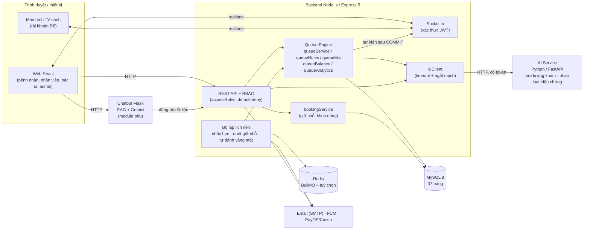

Nguyên tắc: **AI Service và Redis chỉ là phần tăng cường** – chết thì hệ thống vẫn chạy (ETA quay về trung bình lịch sử hoặc 15 phút; nhắc hẹn chạy bằng `setInterval`). Chatbot độc lập, dùng Gemini nên không thuộc phần "tự huấn luyện" của đề cương.

---

## 2. Use case theo vai trò

Tám vai trò (`reference_codes` nhóm `ROLE`): R1 Admin, R2 Bác sĩ, R3 Bệnh nhân, R4 Thu ngân, R5 Lễ tân, R6 Điều dưỡng, R7 Điều phối viên, R8 Thiết bị TV. Quyền thật nằm trong `rbac_role_permissions`, admin chỉnh được; sơ đồ dưới ứng với cấu hình mặc định.

### 2.1 Bệnh nhân (R3) và khách

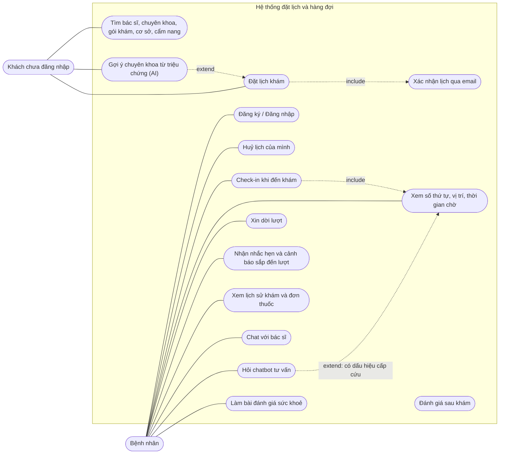

Ghi chú: đặt lịch cho phép khách (cần email để xác nhận); `<<extend>>` trỏ **từ** use case mở rộng **về** use case cơ sở. *Đánh giá sau khám (U15)*: bảng `feedbacks` đã có nhưng **chưa có API/giao diện** – không tính là đã làm.

### 2.2 Nhân viên y tế và vận hành

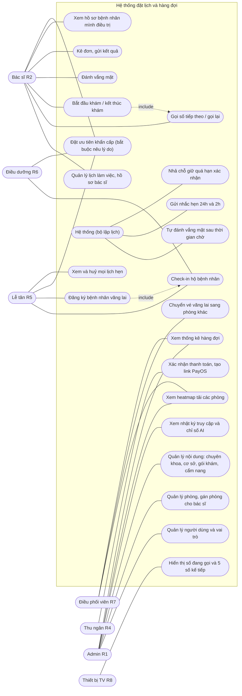

Ghi chú: L2 tự chọn bác sĩ trực chờ ngắn nhất khi bệnh nhân không chỉ định (cân bằng tải). C2 chỉ áp dụng cho vé **vãng lai** đang chờ; vé đã đặt theo bác sĩ không tự ý chuyển. *Chưa làm:* tự động chuyển khi phòng "đỏ" và chuyển vé đã đặt có sự đồng ý của bệnh nhân.

---

## 3. ERD (schema v2)

37 bảng, 50 khoá ngoại. So với `database_schema_v2.md` bản này **bổ sung** các quan hệ còn thiếu (đối chiếu tự động với DDL baseline) và bảng `medicines` (không có khoá ngoại). Các cột tham chiếu `reference_codes` (giới tính, trạng thái, khung giờ, vai trò...) chỉ vẽ một số quan hệ chính để hình khỏi rối.

```mermaid
erDiagram
  reference_codes ||--o{ users : "gender, position"
  reference_codes ||--o{ patient_profiles : "gender"
  reference_codes ||--o{ doctor_profiles : "giá, thanh toán, tỉnh"
  reference_codes ||--o{ schedules : "time_code"
  reference_codes ||--o{ bookings : "status_code, time_code"
  rbac_roles ||--o{ users : role_code
  rbac_roles ||--o{ rbac_role_permissions : has
  rbac_permissions ||--o{ rbac_role_permissions : in
  users ||--o{ refresh_tokens : owns
  users ||--o{ device_tokens : owns
  users ||--o{ access_audit_logs : acts
  users ||--o{ patient_profiles : "chủ hồ sơ"
  users ||--o| doctor_profiles : "bác sĩ"
  users ||--o{ schedules : doctor_id
  users ||--o{ bookings : patient_id
  users ||--o{ notifications : receives
  users ||--o{ messages : "gửi/nhận"
  users ||--o{ health_assessments : makes
  users ||--o{ medical_records : "bác sĩ lập"
  users ||--o{ queue_tickets : "bác sĩ phụ trách"
  users ||--o{ queue_events : "người thao tác"
  users ||--o{ symptom_intakes : "người khai"
  specialties ||--o{ specialty_translations : i18n
  specialties ||--o{ doctor_profiles : ""
  specialties ||--o{ rooms : ""
  specialties ||--o{ packages : ""
  specialties ||--o{ symptom_intakes : "gợi ý"
  clinics ||--o{ clinic_translations : i18n
  clinics ||--o{ rooms : has
  clinics ||--o{ doctor_profiles : ""
  doctor_profiles ||--o{ doctor_profile_translations : i18n
  rooms ||--o{ schedules : room_id
  rooms ||--o{ queue_tickets : ""
  schedules ||--o{ bookings : "doctor_id, work_date, time_code"
  patient_profiles ||--o{ bookings : "người được khám"
  patient_profiles ||--o{ medical_records : ""
  patient_profiles ||--o{ queue_tickets : ""
  bookings ||--o| medical_records : ""
  bookings ||--o| payments : ""
  bookings ||--o| feedbacks : ""
  bookings ||--o| queue_tickets : "NULL = vãng lai"
  bookings ||--o{ symptom_intakes : triage
  queue_tickets ||--o{ queue_events : "nhật ký"
  queue_tickets ||--o{ ai_predictions : "dự đoán và thực tế"
  ml_model_versions ||--o{ ai_predictions : ""
  ml_model_versions ||--o{ symptom_intakes : ""
  facilities ||--o{ packages : offers
  handbooks ||--o{ handbook_translations : i18n
  category_questions ||--o{ questions : ""
  questions ||--o{ question_options : ""
```

Bảng độc lập (không khoá ngoại): `medicines`. Ràng buộc nghiệp vụ quan trọng đặt trong DB: `UNIQUE(room_id, ticket_date, shift, seq)` (số thứ tự không trùng), `UNIQUE(booking_id)` (một lịch hẹn một vé), `UNIQUE(patient_id, work_date, time_code, holder_flag)` (một người không giữ hai lịch cùng giờ), `CHECK(booking_id IS NOT NULL OR walk_in_name IS NOT NULL)`.

---

## 4. Sơ đồ lớp (lớp nghiệp vụ chính)

Vẽ các **thực thể cốt lõi** (khớp bảng) và các **dịch vụ** của lõi hàng đợi. Không vẽ lại toàn bộ 37 bảng (xem ERD) và không vẽ controller/route vì chỉ là lớp mỏng.

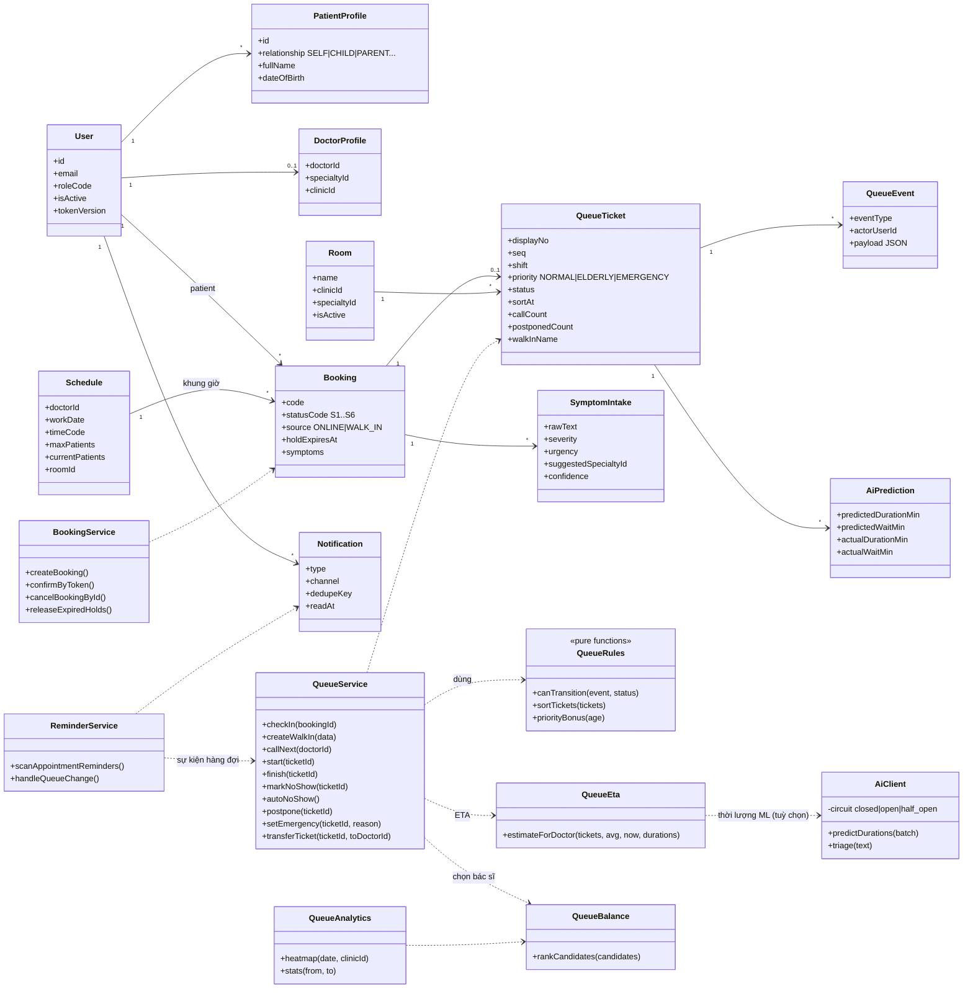

---

## 5. Máy trạng thái

### 5.1 Vé hàng đợi (`queue_tickets.status`)

Vé chỉ được tạo **khi bệnh nhân đến** (check-in hoặc vãng lai) nên bắt đầu ở `WAITING`. `BOOKED`, `CHECKED_IN`, `POSTPONED` có trong ENUM của DB nhưng **chưa dùng**.

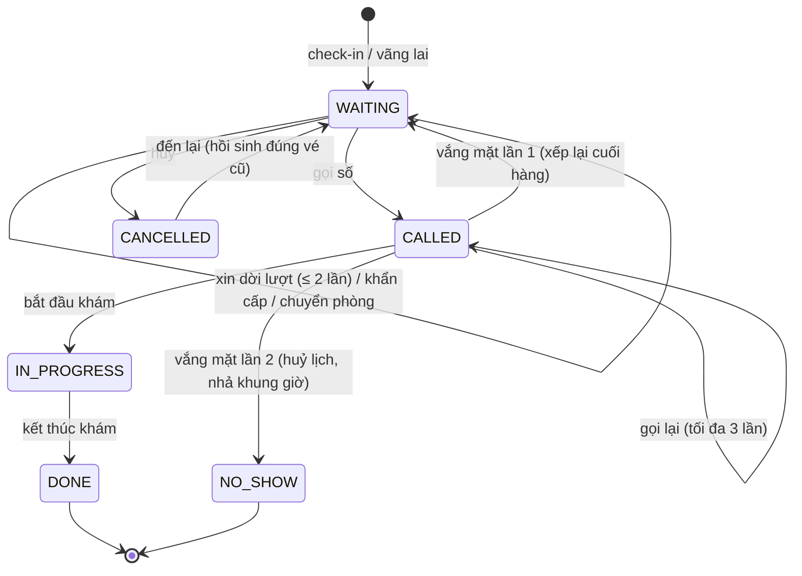

Vắng mặt do bác sĩ bấm cần đã gọi đủ 3 lần; **tự động** sau `NOSHOW_TIMEOUT_MIN` (mặc định 10 phút) kể từ lần gọi gần nhất thì không cần đủ 3 lần (`actor = NULL`, payload `auto: true`).

### 5.2 Lịch hẹn (`bookings.status_code`)

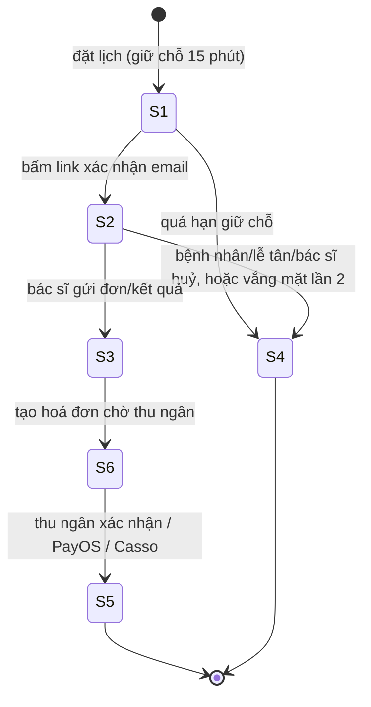

S1 chiếm chỗ **chỉ khi còn trong hạn**. Một lịch hẹn có tối đa một vé hàng đợi; hoàn tất khám ở hàng đợi (`DONE`) và gửi đơn (`S3`) là hai bước độc lập.

---

## 6. Sơ đồ tuần tự

### 6.1 Đặt lịch và xác nhận

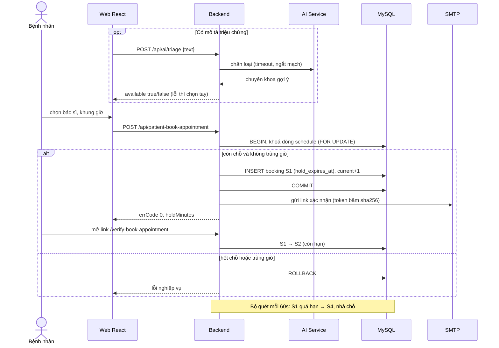

### 6.2 Check-in, gọi số, khám xong (luồng lõi)

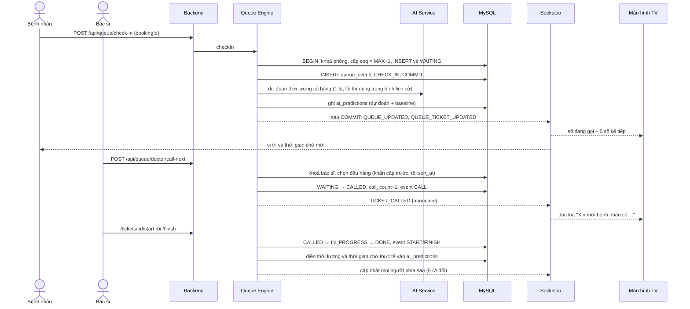

### 6.3 Vãng lai tự chọn bác sĩ và chuyển vé giữa phòng

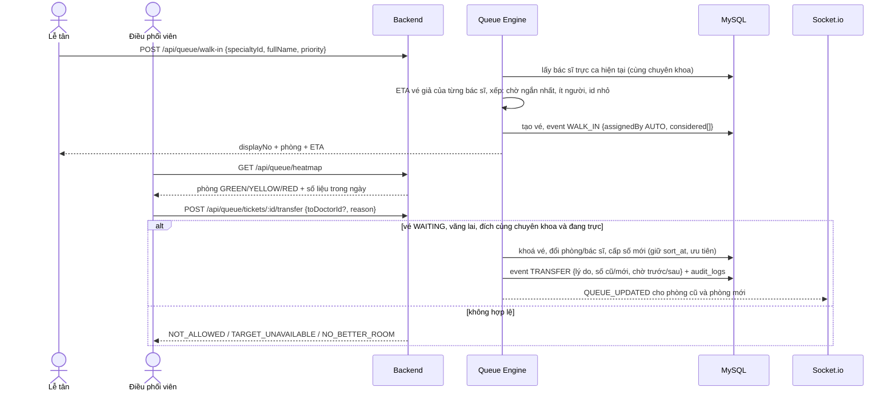

### 6.4 Tự đánh vắng mặt và nhắc hẹn (tác vụ nền)

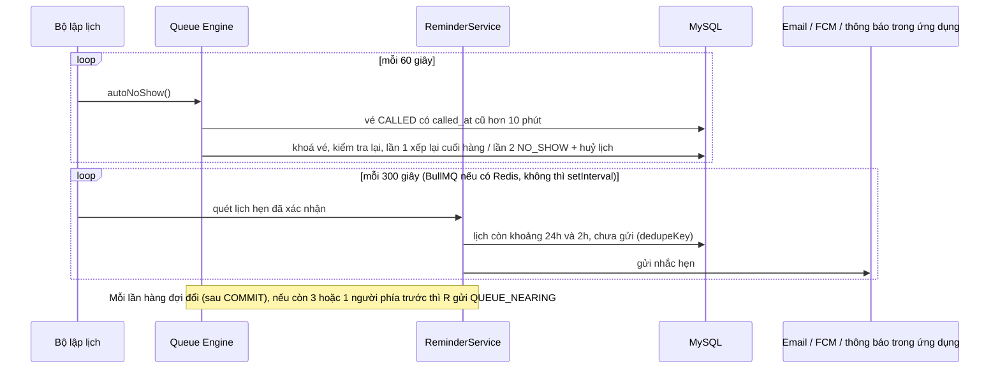

---

## 7. Sơ đồ hoạt động

### 7.1 Hành trình bệnh nhân trong ngày khám

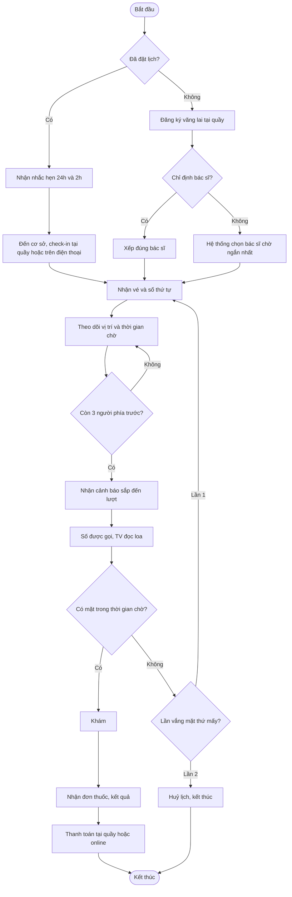

### 7.2 Bác sĩ xử lý hàng đợi

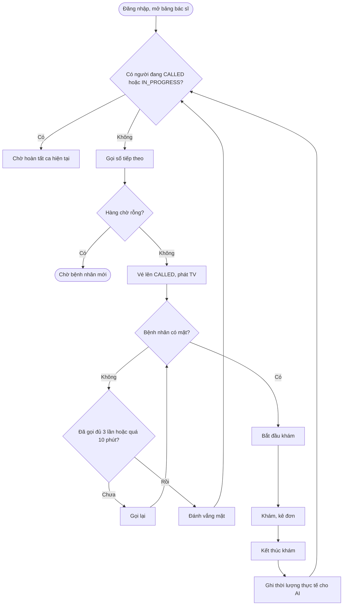

---

## 8. Đối chiếu với sơ đồ cũ

| Sơ đồ cũ | Vấn đề | Trong bản này |
|---|---|---|
| `usecase_diagram.md` | Chỉ có bệnh nhân và bác sĩ; thiếu check-in, hàng đợi, vãng lai, điều phối, TV, tác vụ nền; phân quyền theo nhóm vai trò | §2 theo 8 vai trò + tác nhân hệ thống |
| `class_diagram.md` | Tên bảng/quan hệ theo schema cũ (`Allcodes`, `Doctor_Infor`...) | §3 ERD v2 + §4 lớp nghiệp vụ |
| `sequence_diagrams.md`, `activity_diagrams.md` | Không có check-in, gọi số, ETA, AI, nhắc hẹn, cân bằng tải, chuyển vé; chat, kho thuốc vẫn đúng ý tưởng | §6, §7 cho luồng mới. **Chat bác sĩ, kho thuốc, bài test sức khoẻ không đổi nên chưa vẽ lại** – dùng bản cũ |

**Chưa vẽ vì chưa có trong mã:** đánh giá sau khi khám (bảng `feedbacks` chưa có API), tự động chuyển phòng khi heatmap đỏ, chuyển vé đã đặt lịch.
