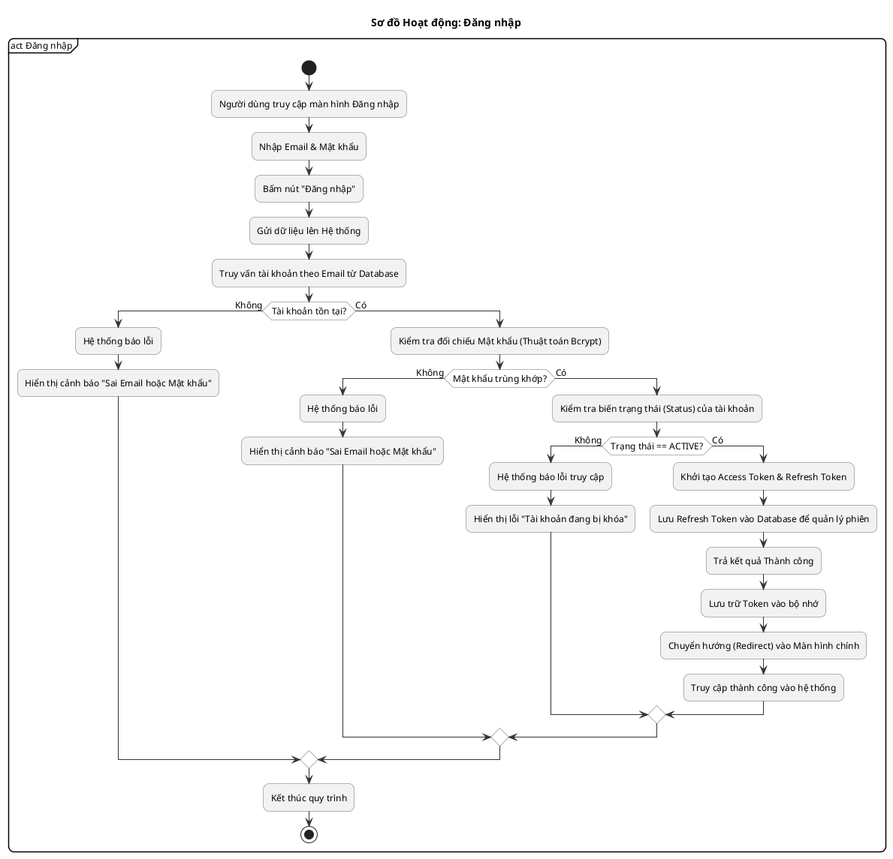
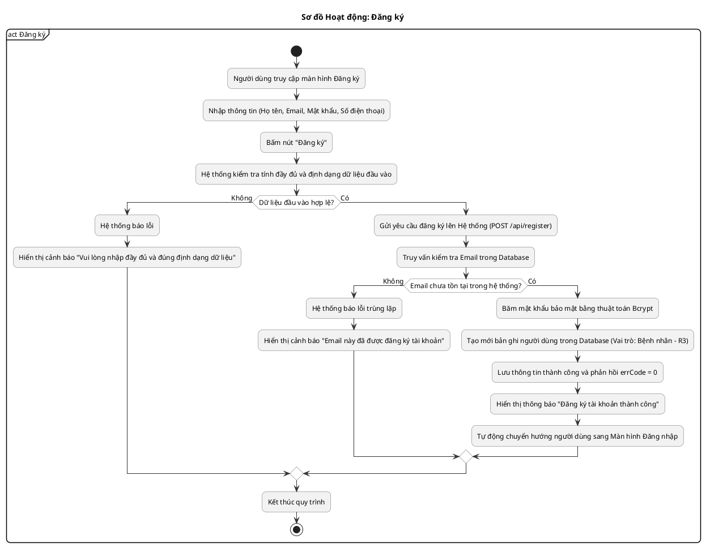
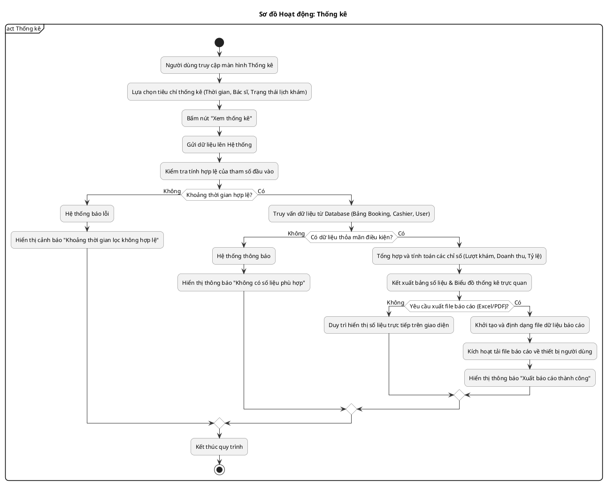
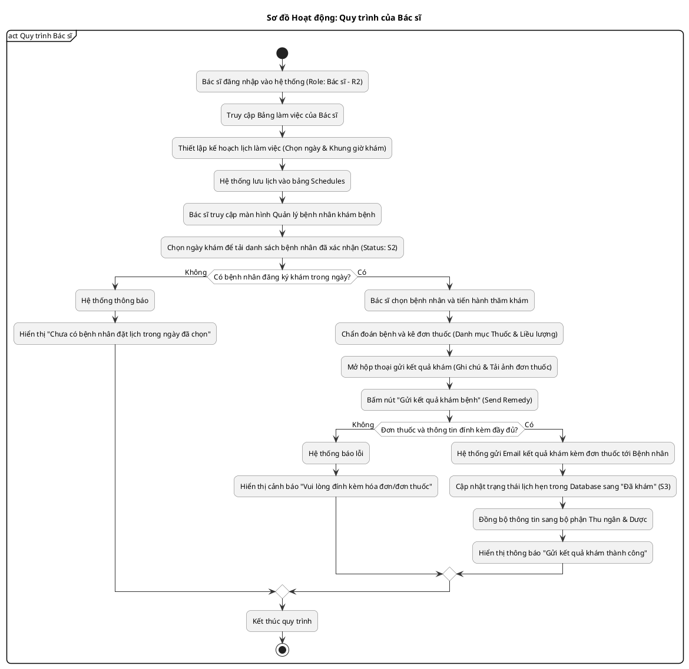
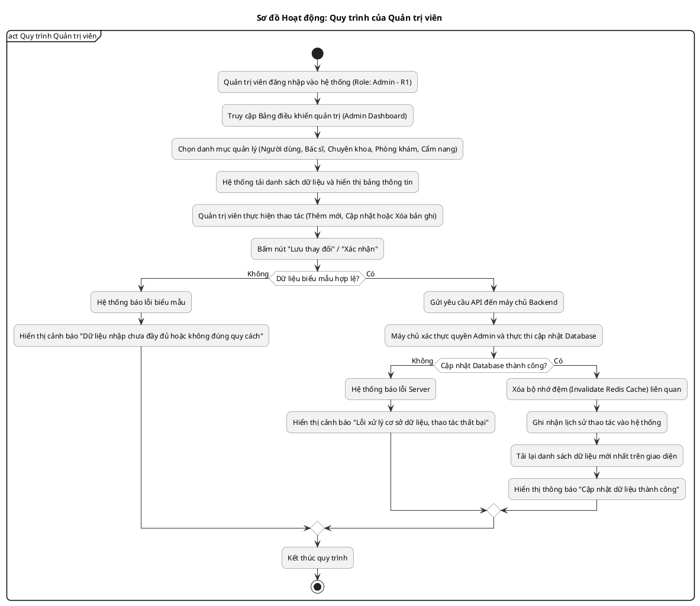
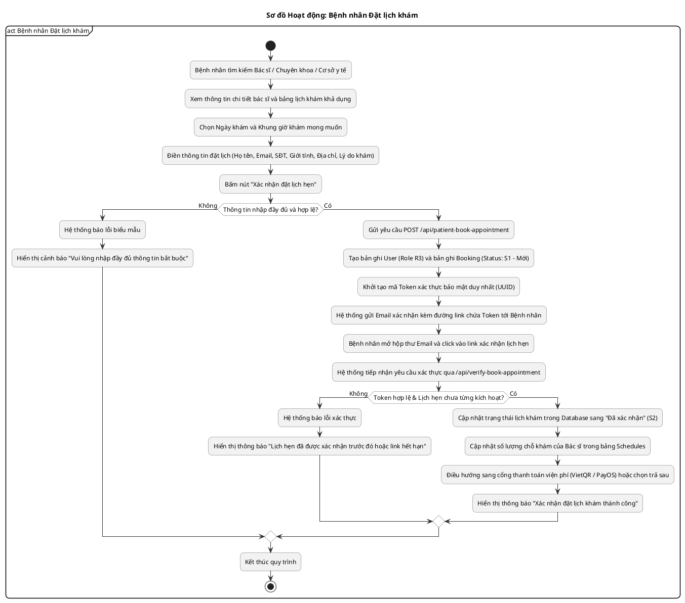
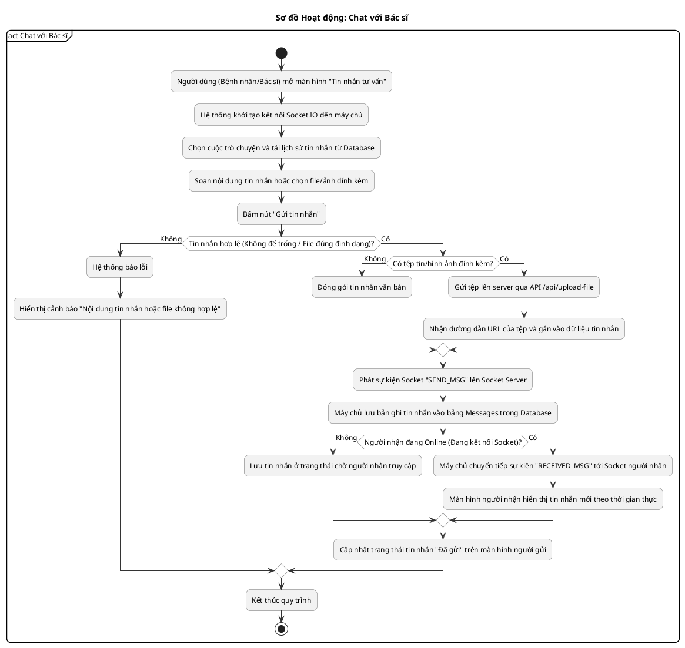
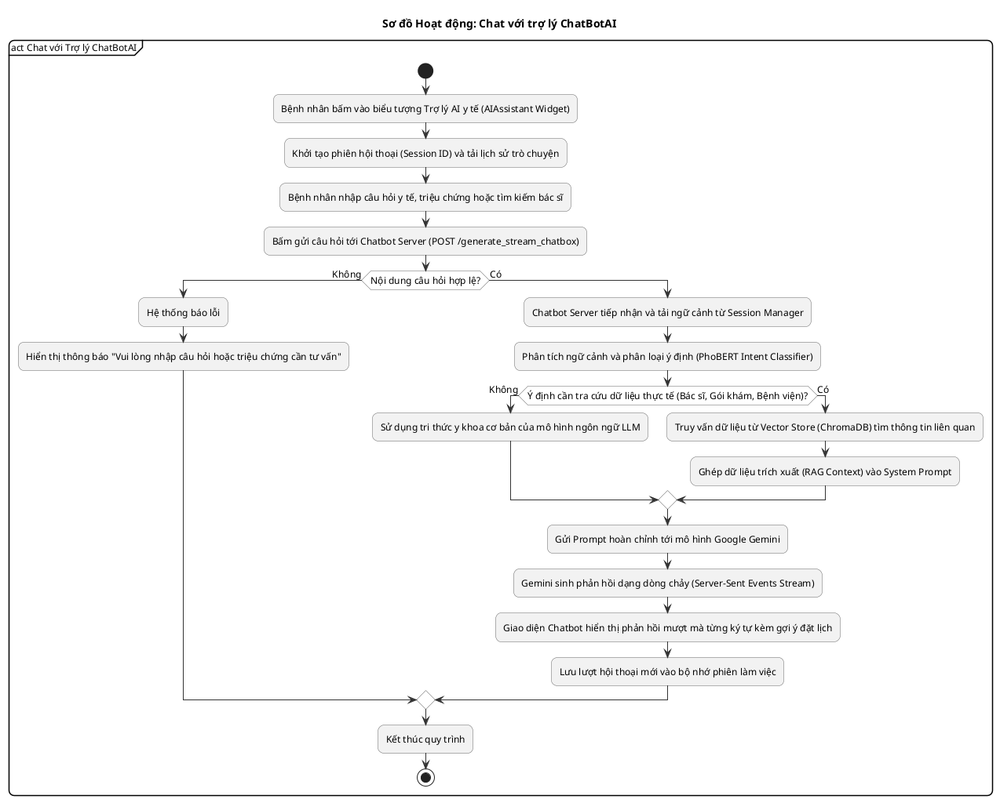
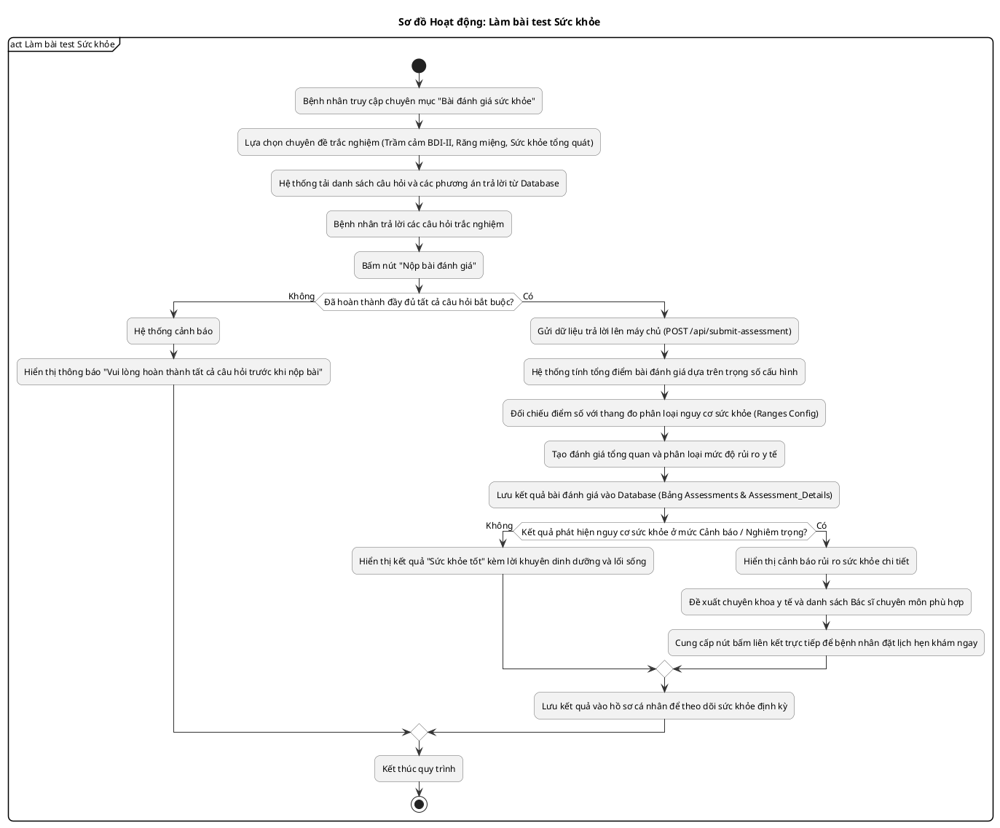
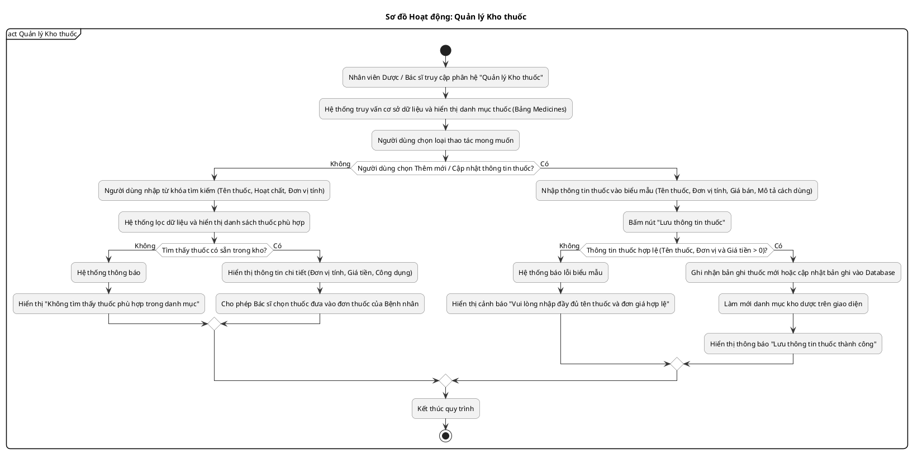

# 📊 Trọn bộ Sơ đồ hoạt động Hệ thống Y tế (UML Activity Diagrams)

Tài liệu này cung cấp toàn bộ mã nguồn **PlantUML** cho 10 sơ đồ hoạt động chính của **Hệ thống đặt lịch khám bệnh trực tuyến (Medical Appointment System)**.

> [!IMPORTANT]
> **Quy chuẩn thiết kế thống nhất cho mọi sơ đồ:**
> - Khung UML bao ngoài dạng phân vùng (`partition "act <Tên quy trình>"`) kèm nhãn đầu gập ở góc trên.
> - **Chỉ duy nhất 1 điểm bắt đầu (`start`) và duy nhất 1 điểm kết thúc (`stop`)**.
> - Nhánh quyết định (Decision diamond) phân bổ đối xứng:
>   - Nhánh `Không` rẽ sang **trái** (thông báo lỗi/ngoại lệ).
>   - Nhánh `Có` rẽ sang **phải** (tiếp tục thực thi nghiệp vụ thành công).
> - Mọi nhánh rẽ đều được gom luồng bằng các hình thoi hội tụ (Merge diamond `<>`) trước khi đi đến khối `:Kết thúc quy trình;` và dừng tại `stop`.
> - Tông màu viền xám tiêu chuẩn UML (`#F2F2F2`, viền `#666666`, bo góc 15px), dán trực tiếp vào **app.diagrams.net** (draw.io) chạy hoàn hảo.

---

## Danh mục sơ đồ trong tài liệu:
1. [Sơ đồ hoạt động: Đăng nhập](#1-sơ-đồ-hoạt-động-đăng-nhập-act-đăng-nhập)
2. [Sơ đồ hoạt động: Đăng ký](#2-sơ-đồ-hoạt-động-đăng-ký-act-đăng-ký)
3. [Sơ đồ hoạt động: Thống kê & Báo cáo](#3-sơ-đồ-hoạt-động-thống-kê--báo-cáo-act-thống-kê)
4. [Sơ đồ hoạt động: Quy trình của Bác sĩ](#4-sơ-đồ-hoạt-động-quy-trình-của-bác-sĩ-act-quy-trình-bác-sĩ)
5. [Sơ đồ hoạt động: Quy trình của Quản trị viên](#5-sơ-đồ-hoạt-động-quy-trình-của-quản-trị-viên-act-quy-trình-quản-trị-viên)
6. [Sơ đồ hoạt động: Bệnh nhân Đặt lịch khám](#6-sơ-đồ-hoạt-động-bệnh-nhân-đặt-lịch-khám-act-bệnh-nhân-đặt-lịch-khám)
7. [Sơ đồ hoạt động: Chat với Bác sĩ](#7-sơ-đồ-hoạt-động-chat-với-bác-sĩ-act-chat-với-bác-sĩ)
8. [Sơ đồ hoạt động: Chat với trợ lý ChatBotAI](#8-sơ-đồ-hoạt-động-chat-với-trợ-lý-chatbotai-act-chat-với-trợ-lý-chatbotai)
9. [Sơ đồ hoạt động: Làm bài test Sức khỏe](#9-sơ-đồ-hoạt-động-làm-bài-test-sức-khỏe-act-làm-bài-test-sức-khỏe)
10. [Sơ đồ hoạt động: Quản lý Kho thuốc](#10-sơ-đồ-hoạt-động-quản-lý-kho-thuốc-act-quản-lý-kho-thuốc)

---

## 1. Sơ đồ Hoạt động: Đăng nhập (`act Đăng nhập`)
*Ánh xạ mã nguồn: [`Login.js`](file:///d:/XuanDuc/CV/medical-appointment-system/frontend/src/containers/Auth/Login.js), [`userController.js:handleLogin`](file:///d:/XuanDuc/CV/medical-appointment-system/backend/src/controllers/userController.js#L30), [`userServices.js:handleUserLogin`](file:///d:/XuanDuc/CV/medical-appointment-system/backend/src/services/userServices.js#L40).*

---

## 2. Sơ đồ Hoạt động: Đăng ký (`act Đăng ký`)
*Ánh xạ mã nguồn: [`userController.js:handleRegister`](file:///d:/XuanDuc/CV/medical-appointment-system/backend/src/controllers/userController.js#L4), [`userServices.js:handleUserRegister`](file:///d:/XuanDuc/CV/medical-appointment-system/backend/src/services/userServices.js#L7).*

---

## 3. Sơ đồ Hoạt động: Thống kê & Báo cáo (`act Thống kê`)
*Ánh xạ mã nguồn: [`doctorServices.js:getListPatientForDoctor`](file:///d:/XuanDuc/CV/medical-appointment-system/backend/src/services/doctorServices.js#L565), Bảng `Bookings`, `Cashiers`.*

---

## 4. Sơ đồ Hoạt động: Quy trình của Bác sĩ (`act Quy trình Bác sĩ`)
*Ánh xạ mã nguồn: [`ManageSchedule.js`](file:///d:/XuanDuc/CV/medical-appointment-system/frontend/src/containers/System/Doctor/ManageSchedule.js), [`ManagePatient.js`](file:///d:/XuanDuc/CV/medical-appointment-system/frontend/src/containers/System/Doctor/ManagePatient.js), [`doctorServices.js:sendRemedyService`](file:///d:/XuanDuc/CV/medical-appointment-system/backend/src/services/doctorServices.js#L705).*

---

## 5. Sơ đồ Hoạt động: Quy trình của Quản trị viên (`act Quy trình Quản trị viên`)
*Ánh xạ mã nguồn: [`UserRedux.js`](file:///d:/XuanDuc/CV/medical-appointment-system/frontend/src/containers/System/Admin/UserRedux.js), [`ManageDoctor.js`](file:///d:/XuanDuc/CV/medical-appointment-system/frontend/src/containers/System/Admin/ManageDoctor.js), [`Specialty.js`](file:///d:/XuanDuc/CV/medical-appointment-system/frontend/src/containers/HomePage/Section/Specialty.js), [`Clinic.js`](file:///d:/XuanDuc/CV/medical-appointment-system/frontend/src/containers/System/Clinic/ManageClinic.js).*

---

## 6. Sơ đồ Hoạt động: Bệnh nhân Đặt lịch khám (`act Bệnh nhân Đặt lịch khám`)
*Ánh xạ mã nguồn: [`patientServices.js:postBookAppointmentServices`](file:///d:/XuanDuc/CV/medical-appointment-system/backend/src/services/patientServices.js#L11), [`postVerifyBookAppointment`](file:///d:/XuanDuc/CV/medical-appointment-system/backend/src/services/patientServices.js#L103).*

---

## 7. Sơ đồ Hoạt động: Chat với Bác sĩ (`act Chat với Bác sĩ`)
*Ánh xạ mã nguồn: [`socket/index.js`](file:///d:/XuanDuc/CV/medical-appointment-system/backend/src/socket/index.js#L30), [`chatController.js`](file:///d:/XuanDuc/CV/medical-appointment-system/backend/src/controllers/chatController.js), [`chatServices.js`](file:///d:/XuanDuc/CV/medical-appointment-system/backend/src/services/chatServices.js).*

---

## 8. Sơ đồ Hoạt động: Chat với trợ lý ChatBotAI (`act Chat với Trợ lý ChatBotAI`)
*Ánh xạ mã nguồn: [`chatbot/app/routes/core.py:generate_stream_chatbox`](file:///d:/XuanDuc/CV/medical-appointment-system/chatbot/app/routes/core.py#L27), [`chatbot/core/chatbot.py`](file:///d:/XuanDuc/CV/medical-appointment-system/chatbot/core/chatbot.py).*

---

## 9. Sơ đồ Hoạt động: Làm bài test Sức khỏe (`act Làm bài test Sức khỏe`)
*Ánh xạ mã nguồn: [`questionController.js`](file:///d:/XuanDuc/CV/medical-appointment-system/backend/src/controllers/questionController.js), [`questionServices.js:submitAssessment`](file:///d:/XuanDuc/CV/medical-appointment-system/backend/src/services/questionServices.js#L27).*

---

## 10. Sơ đồ Hoạt động: Quản lý Kho thuốc (`act Quản lý Kho thuốc`)
*Ánh xạ mã nguồn: [`medicineController.js`](file:///d:/XuanDuc/CV/medical-appointment-system/backend/src/controllers/medicineController.js), [`medicineServices.js`](file:///d:/XuanDuc/CV/medical-appointment-system/backend/src/services/medicineServices.js), Bảng `Medicines`.*

---

## 🛠️ Hướng dẫn vẽ và xuất hình trên draw.io (diagrams.net)

1. Truy cập [app.diagrams.net](https://app.diagrams.net).
2. Trên thanh menu, chọn: **Arrange** (Sắp xếp) ➡️ **Insert** (Chèn) ➡️ **Advanced** (Nâng cao) ➡️ **PlantUML...**
3. Copy toàn bộ khối mã của sơ đồ cần vẽ (từ `@startuml` đến `@enduml`) và dán vào hộp thoại.
4. Bấm **Insert**. Sơ đồ sẽ được tự động vẽ ra bảng vẽ với:
   - Khung bao góc gập `act ...`
   - Đúng duy nhất 1 điểm bắt đầu và 1 điểm kết thúc
   - Nhánh `Không` sang trái, nhánh `Có` sang phải
   - Các hình thoi hội tụ thu luồng chuẩn xác
   - Định dạng khối bo góc và màu sắc xám thanh lịch chuẩn UML.
