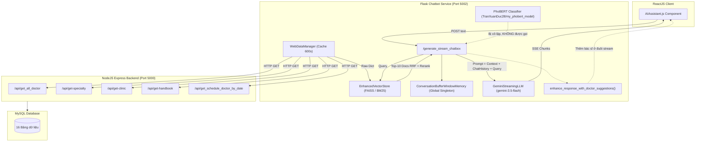
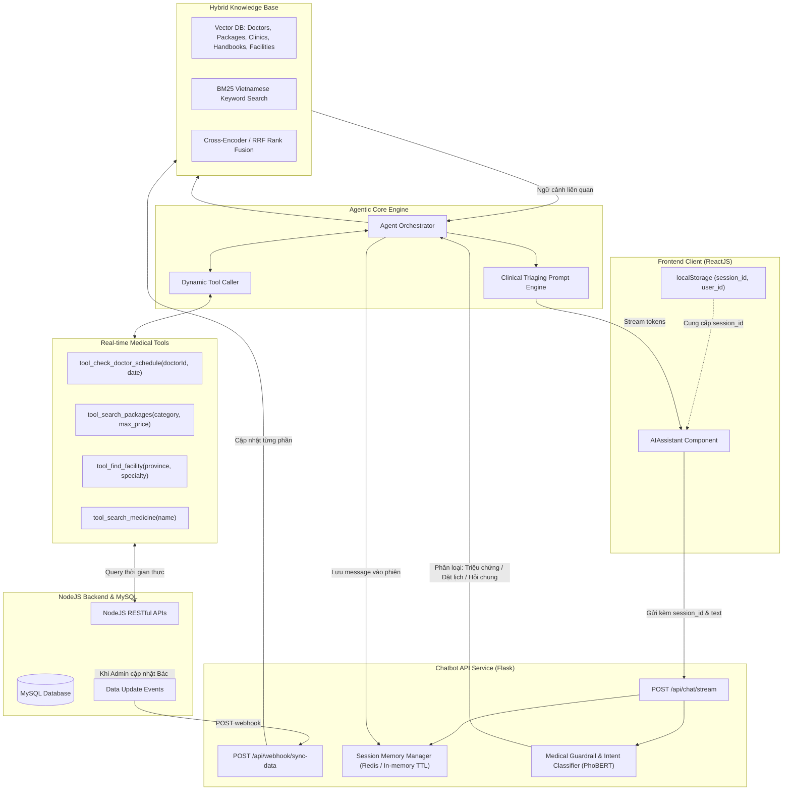

# 📋 BÁO CÁO ĐÁNH GIÁ HIỆN TRẠNG VÀ KẾ HOẠCH NÂNG CẤP TOÀN DIỆN CHATBOT Y TẾ
## Hệ thống Đặt lịch Khám bệnh Trực tuyến (Medical Appointment System)

> **Ngày lập báo cáo:** 29/10/2026  
> **Người thực hiện:** Đội ngũ Kỹ thuật & AI Architecture  
> **Vị trí tài liệu:** `docs/chatbot_evaluation_and_upgrade_plan.md`  
> **Mục tiêu:** Đánh giá chi tiết các điểm đúng/sai của chatbot hiện tại, kiểm tra mức độ nạp dữ liệu từ hệ thống Backend/Database, và vạch ra lộ trình nâng cấp lên chuẩn trợ lý y tế chuyên nghiệp (Production-ready).

---

## 📑 MỤC LỤC
1. [Tổng quan Kiến trúc Hệ thống Chatbot Hiện tại](#1-tổng-quan-kiến-trúc-hệ-thống-chatbot-hiện-tại)
2. [Đánh giá Độ phủ Dữ liệu Hệ thống (Data Ingestion Audit)](#2-đánh-giá-độ-phủ-dữ-liệu-hệ-thống-data-ingestion-audit)
3. [Phân tích Chi tiết Những Điểm Đang Làm Chưa Đúng (Architectural Flaws & Bugs)](#3-phân-tích-chi-tiết-những-điểm-đang-làm-chưa-đúng-architectural-flaws--bugs)
4. [Thiết kế Kiến trúc Mục tiêu (Target Architecture)](#4-thiết-kế-kiến-trúc-mục-tiêu-target-architecture)
5. [Kế hoạch Hành động & Lộ trình Nâng cấp Chi tiết (Actionable Roadmap)](#5-kế-hoạch-hành-động--lộ-trình-nâng-cấp-chi-tiết-actionable-roadmap)
6. [Bảng Tiêu chí Đánh giá Chất lượng Phản hồi (Medical AI Evaluation Metrics)](#6-bảng-tiêu-chí-đánh-giá-chất-lượng-phản-hồi-medical-ai-evaluation-metrics)

---

## 1. TỔNG QUAN KIẾN TRÚC HỆ THỐNG CHATBOT HIỆN TẠI

Hệ thống chatbot y tế hiện tại được xây dựng bằng **Python Flask**, kết hợp với mô hình ngôn ngữ lớn **Google Gemini (gemini-3.5-flash)**, kỹ thuật tìm kiếm thông tin tăng cường **RAG (Retrieval-Augmented Generation)** lai giữa **Dense Vector Search (FAISS/Qdrant)** và **Sparse Keyword Search (BM25)**.

### Sơ đồ luồng hoạt động hiện tại (Current Architecture Flow):



---

## 2. ĐÁNH GIÁ ĐỘ PHỦ DỮ LIỆU HỆ THỐNG (DATA INGESTION AUDIT)

### ❓ Câu hỏi: Chatbot đã tự động nạp hết toàn bộ dữ liệu của hệ thống vào chưa?
> **TRẢ LỜI: CHƯA NẠP HẾT. Chatbot hiện mới chỉ nạp khoảng 35% - 40% khối lượng dữ liệu thực tế của hệ thống.**

Dưới đây là bảng đối chiếu chi tiết giữa **Cơ sở dữ liệu Backend** (`docs/database_schema.md`) và **Dữ liệu Chatbot đã nạp** (`chatbot/core/data/web_data_manager.py` & `enhanced_vector_store.py`):

| Thực thể dữ liệu trong CSDL Backend | API Cung cấp tương ứng | Chatbot Đã Nạp Chưa? | Trạng thái & Tác động thực tế đối với Chatbot |
| :--- | :--- | :---: | :--- |
| **Bác sĩ (`users` + `doctor_infor`)** | `/api/get_all_doctor`, `/api/get-extra-doctor-by-id` |  **Đã nạp 80%** | Đã nạp họ tên, chuyên khoa, phòng khám, giá khám, số điện thoại, ghi chú. Tuy nhiên, đang bị **giới hạn cứng `[:100]` bác sĩ**. |
| **Lịch khám (`schedules`)** | `/api/get_schedule_doctor_by_date` | ⚠️ **Nạp một phần (25%)** | **Chỉ nạp lịch của 2 ngày: Hôm nay và Ngày mai**. Khi người dùng hỏi lịch khám thứ 7, Chủ nhật, hoặc tuần tới $\rightarrow$ Bot trả lời *"Chưa cập nhật lịch khám"* dù trong DB bác sĩ đã có lịch. |
| **Chuyên khoa (`specialties` + `translations`)** | `/api/get-specialty`, `/api/get-detail-specialty-by-id` |  **Đã nạp 90%** | Đã nạp tên chuyên khoa, từ khóa đồng nghĩa và bài viết markdown giới thiệu chi tiết. |
| **Phòng khám (`clinics` + `translations`)** | `/api/get-clinic`, `/api/get-detail-clinic-by-id` |  **Đã nạp 85%** | Đã nạp tên, địa chỉ và bài giới thiệu markdown. |
| **Cẩm nang sức khỏe (`handbooks`)** | `/api/get-handbook`, `/api/get-detail-handbook-by-id` |  **Đã nạp 80%** | Đã nạp tiêu đề, tóm tắt và nội dung markdown. |
| **GÓI KHÁM BỆNH DỊCH VỤ (`packages`)** | `/api/packages/all`, `/api/packages/featured` | ❌ **CHƯA NẠP (0%)** | **BỊ BỎ SÓT HOÀN TOÀN**. Backend có đầy đủ bảng `packages` (Gói khám tổng quát, Gói tầm soát tim mạch, giá tiền, đối tượng nam/nữ, danh mục xét nghiệm `includedServices`, lưu ý nhịn ăn `requirements`). Khi bệnh nhân hỏi: *"Có gói khám tổng quát nào dưới 2 triệu không?"* $\rightarrow$ Bot không có dữ liệu thực tế. |
| **CƠ SỞ Y TẾ ĐỐI TÁC (`facilities`)** | `/api/facilities/all`, `/api/facilities/featured` | ❌ **CHƯA NẠP (0%)** | **BỊ BỎ SÓT HOÀN TOÀN**. Backend có bảng `facilities` hiện đại (phân hạng bệnh viện tuyến trung ương/tỉnh, giờ làm việc, đánh giá sao, chuyên khoa mũi nhọn, địa chỉ chính thức). Chatbot chỉ nạp bảng `clinics` cũ. |
| **DANH MỤC THUỐC & DƯỢC PHẨM (`medicines`)** | `/api/get-medicines` | ❌ **CHƯA NẠP (0%)** | **BỊ BỎ SÓT HOÀN TOÀN**. Backend có bảng thuốc (tên hoạt chất, đơn vị viên/hộp, công dụng, giá tiền niêm yết). Chatbot không có dữ liệu để tư vấn tra cứu đơn thuốc hoặc giá thuốc. |
| **TỪ ĐIỂN MÃ HỆ THỐNG (`allcodes`)** | `/api/allcode` | ❌ **CHƯA NẠP (0%)** | Các metadata như chức danh y khoa (`P0`: Bác sĩ, `P1`: Thạc sĩ, `P2`: Tiến sĩ, `P3`: PGS, `P4`: GS), các khung giờ ca khám (`T1`: 8h-9h...), phương thức thanh toán chưa được vector store hiểu theo cấu trúc chuẩn. |
| **BỘ CÂU HỎI SÀNG LỌC (`questions`, `category_questions`)** | `/api/get-questions` | ❌ **CHƯA NẠP (0%)** | Trong CSDL có sẵn ngân hàng câu hỏi phân tầng để sàng lọc bệnh, nhưng chatbot chưa liên kết để kích hoạt kịch bản hỏi đáp có hướng dẫn (Guided Medical Questionnaire). |

---

## 3. PHÂN TÍCH CHI TIẾT NHỮNG ĐIỂM ĐANG LÀM CHƯA ĐÚNG (ARCHITECTURAL FLAWS & BUGS)

Sau khi rà soát toàn bộ source code của thư mục `chatbot/`, phát hiện **7 vấn đề kỹ thuật nghiêm trọng**:

### 🔴 1. Lỗi Rò rỉ Phiên Hội thoại Đa người dùng (State Leak / Multi-Session Collision)
- **Vị trí:** [chatbot/core/chatbot.py#L24-L29](file:///d:/XuanDuc/CV/medical-appointment-system/chatbot/core/chatbot.py#L24-L29) và [chatbot/app/routes/core.py#L25-L30](file:///d:/XuanDuc/CV/medical-appointment-system/chatbot/app/routes/core.py#L25-L30).
- **Hiện trạng:** 
  ```python
  self.memory = ConversationBufferWindowMemory(
      k=6, memory_key="chat_history", output_key="answer", return_messages=True
  )
  ```
  `enhanced_chatbot` là một biến Singleton duy nhất trong toàn ứng dụng Flask. API `/generate_stream_chatbox` chỉ nhận `{ "text": "..." }`, không hề nhận `sessionId` hay `userId`.
- **Hậu quả:** Tất cả bệnh nhân truy cập website đều **dùng chung một bộ nhớ chat duy nhất**!
  - Bệnh nhân A hỏi: *"Tôi bị đau tức ngực và khó thở..."*
  - Ngay sau đó, Bệnh nhân B vào hỏi: *"Tôi muốn tìm bác sĩ nhi khoa ở Hà Nội..."*
  - Chatbot sẽ đem toàn bộ triệu chứng ngực của Bệnh nhân A nhét vào prompt trả lời cho Bệnh nhân B! Đây là lỗi bảo mật dữ liệu y tế (HIPAA/Privacy) cực kỳ nguy hiểm.

---

### 🔴 2. Tài nguyên chết và Code rác (Dead Code & Wasted Memory)
- **Mô hình PhoBERT (`MedicalClassifier`) bị bỏ quên:**
  - Trong `chatbot/core/classifier/medical_classifier.py`, chatbot nạp model HuggingFace `TranXuanDuc28/my_phobert_model` chiếm hàng trăm MBs RAM và làm chậm quá trình khởi động server.
  - Tuy nhiên, trong cả 2 hàm xử lý chính là `generate_response()` và `generate_streaming_response()`, hàm `is_medical_question()` **HOÀN TOÀN KHÔNG ĐƯỢC GỌI**! Nó chỉ tồn tại trong file test `testing.py`. Bất kỳ câu hỏi nào (kể cả spam, xúc phạm, câu hỏi chính trị hay hỏi lập trình) đều đi thẳng vào Gemini.
- **LangChain Chains không sử dụng:**
  - `self.rag_chain = ConversationalRetrievalChain.from_llm(...)` được khởi tạo phức tạp trong `setup_chains()`, nhưng không bao giờ được gọi khi chat. Chatbot tự ghép string thủ công qua `MEDICAL_SYSTEM_PROMPT.format()`.
  - `self.suggestion_chain = suggestion_prompt | self.llm` cũng được định nghĩa nhưng hàm `get_suggestions()` lại dùng code if/else so sánh chuỗi thô.

---

### 🔴 3. Tool Calling bị ngắt kết nối trong luồng Streaming (Fake Tool Calling)
- **Vị trí:** [chatbot/core/llm/gemini.py#L64-L95](file:///d:/XuanDuc/CV/medical-appointment-system/chatbot/core/llm/gemini.py#L64-L95).
- **Hiện trạng:**
  - `GeminiLLM` (chạy không stream) có gắn `tools=[check_doctor_schedule, check_doctors_by_specialty, check_clinic_info]`.
  - Nhưng Frontend gọi endpoint `/generate_stream_chatbox` $\rightarrow$ Sử dụng `GeminiStreamingLLM`.
  - Trong `GeminiStreamingLLM.stream_response()`, model Gemini được khởi tạo **không có bất kỳ tool nào**:
    ```python
    model = genai.GenerativeModel(self.model_name)
    chat = model.start_chat() # KHÔNG CÓ TOOLS!
    ```
- **Hậu quả:** Chatbot streaming hiện tại chỉ là một hệ thống **Prompt Injection thuần túy**, nhồi 10 documents tìm được từ FAISS vào prompt. Nó không thể tự động nhận biết câu hỏi để gọi hàm tra cứu lịch thời gian thực từ database backend.

---

### 🔴 4. Xung đột nhân đôi danh sách bác sĩ (Double Suggestion Glitch)
- **Vị trí:** [chatbot/core/chatbot.py#L345-L352](file:///d:/XuanDuc/CV/medical-appointment-system/chatbot/core/chatbot.py#L345-L352).
- **Hiện trạng:** 
  - Trong `prompts.py`, System Prompt đã hướng dẫn Gemini: *"Hãy đề xuất 1-2 bác sĩ chuyên khoa phù hợp..."*. Gemini đã tạo danh sách bác sĩ trong nội dung câu trả lời.
  - Nhưng sau khi stream xong, code Python lại chạy tiếp:
    ```python
    doctor_suggestions = self._get_doctor_suggestions_for_streaming(user_message)
    if doctor_suggestions:
        for suggestion_chunk in doctor_suggestions:
            yield suggestion_chunk
    ```
- **Hậu quả:** Trên màn hình của bệnh nhân, danh sách bác sĩ bị hiển thị 2 lần: lần 1 do AI viết theo văn phong tự nhiên, lần 2 do Python append một danh sách cứng ở cuối đoạn chat, gây thừa thãi và mất tính chuyên nghiệp.

---

### 🔴 5. Giới hạn cứng số lượng bản ghi (`Hardcoded Limits [:100]`)
- **Vị trí:** [chatbot/core/data/web_data_manager.py#L49](file:///d:/XuanDuc/CV/medical-appointment-system/chatbot/core/data/web_data_manager.py#L49) & [L73](file:///d:/XuanDuc/CV/medical-appointment-system/chatbot/core/data/web_data_manager.py#L73).
- **Hiện trạng:** `items = data.get("data", [])[:100]`.
- **Hậu quả:** Khi hệ thống có trên 100 bác sĩ hoặc trên 100 phòng khám/bài cẩm nang, dữ liệu từ bản ghi thứ 101 trở đi sẽ bị cắt bỏ vĩnh viễn, vector store không thể tìm thấy.

---

### 🔴 6. Cơ chế Re-indexing làm đơ Server (Blocking In-Memory Rebuild)
- **Vị trí:** [chatbot/core/data/web_data_manager.py#L20-L27](file:///d:/XuanDuc/CV/medical-appointment-system/chatbot/core/data/web_data_manager.py#L20-L27).
- **Hiện trạng:** Sau mỗi 600 giây (10 phút), khi có một request chat gửi đến, `get_web_data()` phát hiện cache hết hạn $\rightarrow$ Bắt đầu tải lại toàn bộ API từ Backend $\rightarrow$ Tính toán lại SentenceTransformer Embeddings $\rightarrow$ Rebuild toàn bộ FAISS index trong RAM.
- **Hậu quả:** Quá trình này ngốn 100% CPU trong 10-15 giây. Bệnh nhân gửi tin nhắn đúng lúc này sẽ bị treo request, timeout hoặc lỗi stream. Đồng thời không hề có Webhook từ Backend khi Admin cập nhật dữ liệu.

---

### 🔴 7. Thiếu Lưu trữ Lịch sử Hội thoại & Phân tích Y khoa (No Chat Persistence / Audit)
- Hiện tại các cuộc trò chuyện của người dùng hoàn toàn biến mất sau khi tắt trình duyệt hoặc restart chatbot.
- Không có bảng `chat_conversations` và `chat_messages` trong database để:
  - Bác sĩ xem lại lịch sử tư vấn khi bệnh nhân đến khám.
  - Quản trị viên giám sát chất lượng tư vấn, phát hiện hallucination (ảo giác AI) hoặc câu trả lời sai lệch y khoa.

---

## 4. THIẾT KẾ KIẾN TRÚC MỤC TIÊU (TARGET ARCHITECTURE)

Nhằm giải quyết triệt để 7 vấn đề trên, kiến trúc mục tiêu của Chatbot Y tế được nâng cấp theo chuẩn **Agentic RAG + Session-based Memory + Event-driven Cache Sync**:



---

## 5. KẾ HOẠCH HÀNH ĐỘNG & LỘ TRÌNH NÂNG CẤP CHI TIẾT (ACTIONABLE ROADMAP)

Lộ trình được chia thành **4 giai đoạn trọng tâm**:

### 🚀 Giai đoạn 1: Khắc phục Lỗi Cốt lõi & Quản lý Phiên Đa người dùng (Đã hoàn thành ✅)
- [x] **1.1. Xây dựng `SessionMemoryManager`:**
  - Quản lý lịch sử hội thoại riêng biệt theo `session_id`.
  - Hỗ trợ lưu trữ tin nhắn theo từng phiên, tự động giải phóng phiên sau 2 giờ không hoạt động (TTL) để không tràn RAM.
  - Sửa frontend `AIAssistant.js`: Tự động sinh và lưu `session_id` trong `localStorage` và gửi kèm trong body request: `{ "session_id": "...", "text": "..." }`.
- [x] **1.2. Dọn dẹp Dead Code & Tối ưu Startup:**
  - Loại bỏ các biến chain không dùng (`self.rag_chain`, `self.suggestion_chain`), tối ưu singleton trong `main.py`.
  - Đưa `medical_classifier` (PhoBERT) vào luồng: Tự động phân loại, chặn câu hỏi phi y tế và chuyển hướng người dùng lịch sự.
  - Tích hợp phát hiện dấu hiệu cấp cứu đỏ (`check_emergency`) và câu chào hỏi thân thiện (`check_greeting`).
- [x] **1.3. Khắc phục lỗi lặp lại danh sách Bác sĩ:**
  - Bỏ đoạn code append cứng `_get_doctor_suggestions_for_streaming` ở cuối stream, chỉ để LLM Gemini sinh gợi ý bác sĩ tự nhiên dựa trên prompt và context.

---

### 🏥 Giai đoạn 2: Hoàn thiện Độ phủ Dữ liệu Đạt 100% (Đã hoàn thành ✅)
- [x] **2.1. Nạp Gói khám bệnh (`packages`):**
  - Đã tích hợp gọi `/api/packages/all` trong `web_data_manager.py`.
  - Xử lý document trong vector store: Tên gói khám, giá tiền, đối tượng (nam/nữ/độ tuổi), danh mục xét nghiệm đi kèm (`includedServices`), hướng dẫn chuẩn bị (`requirements`), lưu ý (`notes`).
- [x] **2.2. Nạp Cơ sở Y tế đối tác (`facilities`):**
  - Đã tích hợp gọi `/api/facilities/all`.
  - Đưa thông tin phân hạng bệnh viện, giờ làm việc, chuyên khoa mũi nhọn, địa chỉ và đánh giá chất lượng vào vector store.
- [x] **2.3. Nạp Danh mục Thuốc (`medicines`):**
  - Đã tích hợp gọi `/api/get-medicines`.
  - Nạp thông tin hoạt chất, quy cách đóng gói, giá niêm yết và công dụng chính vào vector store.
- [x] **2.4. Mở rộng Lịch khám (`schedules`):**
  - Đã mở rộng lấy lịch khám trong **7 ngày liên tiếp** (`Hôm nay`, `Ngày mai`, `Thứ X (dd/mm)`) của tất cả bác sĩ.
- [x] **2.5. Xóa bỏ giới hạn cứng `[:100]`:**
  - Nạp toàn bộ danh sách thực tế của hệ thống không bị giới hạn.

---

### 🧠 Giai đoạn 3: Nâng cấp Dynamic Tools & Reranker Thông minh (Đã hoàn thành ✅)
- [x] **3.1. Bổ sung Tools trong `tools.py` và `gemini.py`:**
  - Bổ sung `check_packages(keyword)` và `check_medicine_info(medicine_name)`.
  - Tích hợp vào danh sách Function Calling của GeminiLLM.
- [x] **3.2. Nâng cấp Hybrid Search Reranking:**
  - Tối ưu bộ tăng trọng số (Boost Score) trong `hybrid_search_with_rerank` cho cả `package`, `facility`, `medicine`, `doctor`, `specialty`, `clinic`.
- [x] **3.3. Tối ưu System Prompt chuẩn Y tế:**
  - Cập nhật `config/prompts.py` với hướng dẫn lâm sàng chi tiết, quy định phân luồng khi hỏi Bác sĩ, Gói khám, Bệnh viện, Thuốc và tuyên bố miễn trừ trách nhiệm.

---

### 🔄 Giai đoạn 4: Đồng bộ Tự động (Event-driven Sync) & Webhook (Đã hoàn thành ✅)
- [x] **4.1. Webhook Cache Invalidation:**
  - Tạo endpoint `POST /api/webhook/sync_data` và `POST /refresh_data` trên Chatbot Flask.
  - Cập nhật `backend/src/utils/redis.js`: Hàm `invalidateCache` tự động gửi tín hiệu Webhook sang Chatbot service để làm mới dữ liệu tự động.
- [x] **4.2. Kiểm thử và Xác minh Hệ thống (System Verification):**
  - Đã kiểm thử thành công: Cảnh báo khẩn cấp (Red Flags), Câu chào hỏi (Greeting), Truy vấn Gói khám (Packages), Truy vấn Bệnh viện (Facilities), Truy vấn Thuốc (Medicines) và Kiểm tra phân tách phiên (Session Isolation).

---

## 6. BẢNG TIÊU CHÍ ĐÁNH GIÁ CHẤT LƯỢNG PHẢN HỒI (MEDICAL AI EVALUATION METRICS)

Để đảm bảo chatbot đạt chuẩn một trợ lý y tế chuyên nghiệp phục vụ đồ án và môi trường thực tế, hệ thống cần được đánh giá định kỳ theo các chỉ số:

| Chỉ số đánh giá | Định nghĩa & Tiêu chuẩn mục tiêu | Cách đo lường |
| :--- | :--- | :--- |
| **Độ chính xác dữ liệu (Faithfulness)** | Phản hồi về giá khám, lịch làm việc, địa chỉ bác sĩ phải khớp **100%** với dữ liệu MySQL, không hallucinate. | So khớp thông tin trong câu trả lời với kết quả query DB thực tế. |
| **Tính cách ly phiên (Session Isolation)** | Hai người dùng khác nhau chat cùng lúc không bị rò rỉ bất kỳ thông tin nào của nhau (**100%**). | Chạy kịch bản test đồng thời (Concurrency Test) với 5 session song song. |
| **Thời gian phản hồi Token đầu (TTFT)** | Thời gian từ lúc nhấn gửi đến khi chunk chữ đầu tiên hiện ra: **< 1.2 giây**. | Đo thời gian bằng timer ở client. |
| **An toàn Cấp cứu (Emergency Recall)** | Nhận diện chính xác **100%** các trường hợp khẩn cấp để đưa ra khuyến cáo 115. | Bộ test gồm 50 ca bệnh cấp cứu kinh điển. |
| **Trải nghiệm Đặt lịch (Actionability)** | Đưa ra được gợi ý hành động cụ thể (Link đặt lịch, số điện thoại, khung giờ còn trống). | Kiểm tra sự hiện diện của Action Link trong câu trả lời. |

---

## 7. KẾT LUẬN & KIẾN NGHỊ

Hệ thống chatbot hiện tại đã có nền tảng rất tốt về **Hybrid Search (FAISS + BM25)**, prompt phân luồng triệu chứng và kết nối mô hình Gemini 3.5 hiện đại. Tuy nhiên, việc **bỏ sót 60% dữ liệu hệ thống (đặc biệt là Gói khám và Bệnh viện đối tác)** cùng lỗi **chia sẻ chung bộ nhớ đa người dùng** là 2 điểm nghẽn lớn nhất cần được xử lý ngay lập tức.

Việc triển khai nâng cấp theo kế hoạch 4 giai đoạn trên sẽ nâng tầm chatbot từ một công cụ tra cứu thông tin cơ bản thành một **Trợ lý Sàng lọc Y tế Toàn diện (Clinical AI Assistant)**, tạo điểm nhấn kỹ thuật xuất sắc cho toàn bộ đồ án và sẵn sàng đưa vào vận hành thực tế.
