# 🏛️ Sơ đồ Lớp Tổng thể Hệ thống (UML Class Diagram)

Tài liệu này cung cấp mã nguồn **PlantUML** cho Sơ đồ lớp (Class Diagram) của **Hệ thống đặt lịch khám bệnh trực tuyến (Medical Appointment System)** được sửa lỗi tương thích 100% với **draw.io**.

> [!NOTE]
> **Giải thích thông báo lỗi:**
> - Cảnh báo: `this line matched no class diagram statement and was dropped: "rectangle ..."`
> - **Nguyên nhân**: Trong chuẩn UML Class Diagram, từ khóa `rectangle` thuộc về sơ đồ khối/kiến trúc nên bộ chuyển đổi của draw.io không chấp nhận và tự động loại bỏ.
> - **Cách khắc phục chuẩn**: Trong sơ đồ lớp UML, từ khóa duy nhất để tạo **1 khung bao quanh duy nhất** là **`package "Tên khung" { ... }`**.

---

## 💻 1. Bản gộp chung trong 1 Khung bao duy nhất (`package`)

*Khung `package` bao trọn toàn bộ các lớp thực thể và mối liên kết của hệ thống.*

```plantuml
@startuml
skinparam classAttributeIconSize 0
skinparam shadowing false
skinparam defaultFontName "Times New Roman"
skinparam defaultFontSize 12
skinparam roundCorner 8
skinparam class {
    BackgroundColor #FFFFFF
    ArrowColor #2C3E50
    BorderColor #2C3E50
}

package "Sơ đồ Lớp Hệ thống Đặt lịch Khám bệnh trực tuyến (Medical Appointment System)" {
    
    ' ====== 1. NGƯỜI DÙNG & PHÂN QUYỀN ======
    class User {
        - id: Long
        - email: String
        - password: String
        - firstName: String
        - lastName: String
        - address: String
        - phoneNumber: String
        - gender: String
        - roleId: String
        - positionId: String
        - groupId: Integer
        - fcmToken: Text
        + register(): Boolean
        + login(): TokenResponse
        + updateProfile(): Boolean
        + changePassword(): Boolean
        + saveFCMToken(): Boolean
    }

    class Group {
        - id: Integer
        - name: String
        - description: String
        + addRole(role: Role): void
        + removeRole(roleId: Integer): void
        + getRoles(): List<Role>
    }

    class Role {
        - id: Integer
        - url: String
        - description: String
        + verifyPermission(): Boolean
    }

    class AllCode {
        - id: Integer
        - keyMap: String
        - type: String
        - valueEn: String
        - valueVi: String
        + getCodesByType(type: String): List<AllCode>
    }

    ' ====== 2. KHÁM CHỮA BỆNH & LỊCH HẸN ======
    class Booking {
        - id: String
        - statusId: String
        - doctorId: Long
        - patientId: Long
        - date: String
        - timeType: String
        - token: String
        + createBooking(): Boolean
        + verifyBooking(token: String): Boolean
        + cancelBooking(): Boolean
        + updateStatus(statusId: String): Boolean
    }

    class Schedule {
        - id: Long
        - currentNumber: Integer
        - maxNumber: Integer
        - date: String
        - timeType: String
        - doctorId: Long
        + checkAvailability(): Boolean
        + incrementCurrentNumber(): void
        + bulkCreateSchedule(data: List): Boolean
    }

    class Doctor_Infor {
        - id: Long
        - doctorId: Long
        - priceId: String
        - provinceId: String
        - paymentId: String
        - addressClinic: String
        - nameClinic: String
        - note: String
        - count: Integer
        - specialtyId: Integer
        - clinicId: Integer
        + getDoctorDetails(): Object
        + saveDetailInforDoctor(): Boolean
    }

    class History {
        - id: Long
        - patientId: Long
        - doctorId: Long
        - description: String
        - files: String
        + saveMedicalRecord(): Boolean
        + getPatientHistory(): List
    }

    class Cashier {
        - id: Long
        - bookingId: String
        - amount: Double
        - paymentMethod: String
        - status: String
        - transactionId: String
        + confirmPayment(): Boolean
        + createPaymentLink(): String
        + verifyWebhook(): Boolean
    }

    ' ====== 3. CƠ SỞ & CHUYÊN KHOA ======
    class Specialty {
        - id: Integer
        - image: String
        - description: Text
        + getAllSpecialties(): List<Specialty>
        + createSpecialty(): Boolean
        + getSpecialtyById(id: Integer): Specialty
    }

    class Clinic {
        - id: Integer
        - address: String
        - image: String
        + getAllClinics(): List<Clinic>
        + createClinic(): Boolean
        + getClinicById(id: Integer): Clinic
    }

    class Facility {
        - id: Integer
        - name: String
        - address: String
        - description: Text
        - image: String
        - logo: String
        + getAllFacilities(): List<Facility>
        + getFeaturedFacilities(): List<Facility>
        + searchFacilities(): List<Facility>
    }

    class Package {
        - id: Integer
        - name: String
        - price: Double
        - facilityId: Integer
        - specialtyId: Integer
        - description: Text
        - isActive: Boolean
        + getAllPackages(): List<Package>
        + getFeaturedPackages(): List<Package>
        + searchPackages(): List<Package>
    }

    ' ====== 4. TƯ VẤN, ĐÁNH GIÁ SỨC KHỎE & KHO DƯỢC ======
    class Message {
        - id: Long
        - senderId: Long
        - receiverId: Long
        - message: Text
        - fileUrl: String
        + sendMessage(): Boolean
        + getMessages(): List<Message>
        + deleteMessage(id: Long): Boolean
    }

    class CategoryQuestion {
        - id: Integer
        - name: String
        - description: String
        + getAllCategories(): List
        + getQuestionsByCategory(): List
    }

    class Question {
        - id: Integer
        - category_question_id: Integer
        - question_text: Text
        - question_type: String
        + createQuestion(): Boolean
        + getOptions(): List<QuestionOption>
    }

    class QuestionOption {
        - id: Integer
        - question_id: Integer
        - option_text: String
        - score: Integer
    }

    class HealthAssessment {
        - id: Long
        - user_id: String
        - total_score: Integer
        - max_score: Integer
        - percentage: Double
        - health_level: String
        - answers: JSON
        - ai_advice: Text
        - completed_at: Date
        + calculateScore(): Integer
        + submitAssessment(): Object
        + getHistoryByUserId(userId: String): List
    }

    class Medicine {
        - id: Long
        - name: String
        - unit: String
        - description: Text
        - price: Float
        + getAllMedicines(): List<Medicine>
    }

    ' ====== CÁC ĐƯỜNG QUAN HỆ TRONG HỆ THỐNG ======
    User "0..*" -- "0..1" Group : thuộc nhóm
    Group "1" *-- "0..*" Role : cấp quyền
    User "0..*" -- "1" AllCode : vai trò / chức danh / giới tính

    User "1" -- "0..1" Doctor_Infor : thông tin chi tiết bác sĩ
    User "1" -- "0..*" Schedule : tạo lịch khám
    User "1" -- "0..*" Booking : đặt lịch hẹn (Bệnh nhân)
    User "1" -- "0..*" Booking : tiếp nhận khám (Bác sĩ)
    Booking "0..*" -- "1" Schedule : thuộc khung giờ
    Booking "1" -- "0..1" Cashier : thanh toán viện phí
    Booking "0..*" -- "1" AllCode : trạng thái (statusId)

    Specialty "1" -- "0..*" Doctor_Infor : thuộc chuyên khoa
    Clinic "1" -- "0..*" Doctor_Infor : làm việc tại
    Facility "1" -- "0..*" Package : cung cấp gói khám
    Specialty "1" -- "0..*" Package : phân loại chuyên môn

    User "1" -- "0..*" History : bệnh án khám bệnh
    User "1" -- "0..*" Message : gửi / nhận tin nhắn
    Booking "0..*" ..> "0..*" Medicine : kê đơn thuốc (Remedy)

    CategoryQuestion "1" *-- "0..*" Question : chứa danh sách câu hỏi
    Question "1" *-- "1..*" QuestionOption : có các phương án lựa chọn
    User "1" -- "0..*" HealthAssessment : thực hiện bài đánh giá
}
@enduml
```

---

## 💻 2. Bản phẳng tự nhiên (Không dùng khung bao - Dễ căn chỉnh kéo thả nhất)

*Bản vẽ trực quan không có khung ngoài bao bọc, các class tự do kết nối, rất tiện nếu bạn muốn tự kéo thả sắp xếp vị trí các class trên draw.io:*

```plantuml
@startuml
skinparam classAttributeIconSize 0
skinparam shadowing false
skinparam defaultFontName "Times New Roman"
skinparam defaultFontSize 12
skinparam roundCorner 8
skinparam class {
    BackgroundColor #FFFFFF
    ArrowColor #2C3E50
    BorderColor #2C3E50
}

' ====== 1. NGƯỜI DÙNG & PHÂN QUYỀN ======
class User {
    - id: Long
    - email: String
    - password: String
    - firstName: String
    - lastName: String
    - address: String
    - phoneNumber: String
    - gender: String
    - roleId: String
    - positionId: String
    - groupId: Integer
    - fcmToken: Text
    + register(): Boolean
    + login(): TokenResponse
    + updateProfile(): Boolean
    + changePassword(): Boolean
}

class Group {
    - id: Integer
    - name: String
    - description: String
    + addRole(role: Role): void
    + removeRole(roleId: Integer): void
}

class Role {
    - id: Integer
    - url: String
    - description: String
    + verifyPermission(): Boolean
}

class AllCode {
    - id: Integer
    - keyMap: String
    - type: String
    - valueEn: String
    - valueVi: String
    + getCodesByType(type: String): List
}

' ====== 2. KHÁM CHỮA BỆNH & LỊCH HẸN ======
class Booking {
    - id: String
    - statusId: String
    - doctorId: Long
    - patientId: Long
    - date: String
    - timeType: String
    - token: String
    + createBooking(): Boolean
    + verifyBooking(token: String): Boolean
    + cancelBooking(): Boolean
    + updateStatus(statusId: String): Boolean
}

class Schedule {
    - id: Long
    - currentNumber: Integer
    - maxNumber: Integer
    - date: String
    - timeType: String
    - doctorId: Long
    + checkAvailability(): Boolean
    + incrementCurrentNumber(): void
}

class Doctor_Infor {
    - id: Long
    - doctorId: Long
    - priceId: String
    - provinceId: String
    - paymentId: String
    - addressClinic: String
    - nameClinic: String
    - note: String
    - count: Integer
    - specialtyId: Integer
    - clinicId: Integer
    + getDoctorDetails(): Object
    + saveDetailInforDoctor(): Boolean
}

class History {
    - id: Long
    - patientId: Long
    - doctorId: Long
    - description: String
    - files: String
    + saveMedicalRecord(): Boolean
}

class Cashier {
    - id: Long
    - bookingId: String
    - amount: Double
    - paymentMethod: String
    - status: String
    - transactionId: String
    + confirmPayment(): Boolean
    + createPaymentLink(): String
}

' ====== 3. CƠ SỞ & CHUYÊN KHOA ======
class Specialty {
    - id: Integer
    - image: String
    - description: Text
    + getAllSpecialties(): List
    + getSpecialtyById(id: Integer): Specialty
}

class Clinic {
    - id: Integer
    - address: String
    - image: String
    + getAllClinics(): List
    + getClinicById(id: Integer): Clinic
}

class Facility {
    - id: Integer
    - name: String
    - address: String
    - description: Text
    - image: String
    - logo: String
    + getAllFacilities(): List
}

class Package {
    - id: Integer
    - name: String
    - price: Double
    - facilityId: Integer
    - specialtyId: Integer
    - description: Text
    - isActive: Boolean
    + getAllPackages(): List
}

' ====== 4. TƯ VẤN, ĐÁNH GIÁ SỨC KHỎE & KHO DƯỢC ======
class Message {
    - id: Long
    - senderId: Long
    - receiverId: Long
    - message: Text
    - fileUrl: String
    + sendMessage(): Boolean
    + getMessages(): List
}

class CategoryQuestion {
    - id: Integer
    - name: String
    - description: String
    + getAllCategories(): List
}

class Question {
    - id: Integer
    - category_question_id: Integer
    - question_text: Text
    - question_type: String
    + getOptions(): List
}

class QuestionOption {
    - id: Integer
    - question_id: Integer
    - option_text: String
    - score: Integer
}

class HealthAssessment {
    - id: Long
    - user_id: String
    - total_score: Integer
    - max_score: Integer
    - percentage: Double
    - health_level: String
    - answers: JSON
    - ai_advice: Text
    + calculateScore(): Integer
    + submitAssessment(): Object
}

class Medicine {
    - id: Long
    - name: String
    - unit: String
    - description: Text
    - price: Float
    + getAllMedicines(): List
}

' ====== LIÊN KẾT GIỮA CÁC LỚP ======
User "0..*" -- "0..1" Group : thuộc nhóm
Group "1" *-- "0..*" Role : cấp quyền
User "0..*" -- "1" AllCode : vai trò / chức danh / giới tính

User "1" -- "0..1" Doctor_Infor : thông tin chi tiết bác sĩ
User "1" -- "0..*" Schedule : tạo lịch khám
User "1" -- "0..*" Booking : đặt lịch hẹn (Bệnh nhân)
User "1" -- "0..*" Booking : tiếp nhận khám (Bác sĩ)
Booking "0..*" -- "1" Schedule : thuộc khung giờ
Booking "1" -- "0..1" Cashier : thanh toán viện phí
Booking "0..*" -- "1" AllCode : trạng thái (statusId)

Specialty "1" -- "0..*" Doctor_Infor : thuộc chuyên khoa
Clinic "1" -- "0..*" Doctor_Infor : làm việc tại
Facility "1" -- "0..*" Package : cung cấp gói khám
Specialty "1" -- "0..*" Package : phân loại chuyên môn

User "1" -- "0..*" History : bệnh án khám bệnh
User "1" -- "0..*" Message : gửi / nhận tin nhắn
Booking "0..*" ..> "0..*" Medicine : kê đơn thuốc (Remedy)

CategoryQuestion "1" *-- "0..*" Question : chứa danh sách câu hỏi
Question "1" *-- "1..*" QuestionOption : có các phương án lựa chọn
User "1" -- "0..*" HealthAssessment : thực hiện bài đánh giá
@enduml
```

