# 🗄️ Thiết kế Cơ sở dữ liệu Hệ thống Đặt lịch Khám bệnh trực tuyến (Medical Appointment System)

Tài liệu này tổng hợp toàn bộ cấu trúc cơ sở dữ liệu MySQL của hệ thống đặt lịch khám bệnh trực tuyến, phục vụ cho báo cáo đồ án tốt nghiệp, tài liệu kỹ thuật và thiết kế hệ thống.

---

## Hình 4.20: Sơ đồ Cơ sở dữ liệu của hệ thống (Entity Relationship Diagram - ERD)

```mermaid
erDiagram
    USERS ||--o{ BOOKINGS : "đặt lịch (patientId)"
    USERS ||--o{ BOOKINGS : "tiếp nhận khám (doctorId)"
    USERS ||--o{ SCHEDULES : "quản lý lịch làm việc (doctorId)"
    USERS ||--o| DOCTOR_INFOR : "thông tin chi tiết bác sĩ (doctorId)"
    USERS ||--o| MARKDOWNS : "bài viết hồ sơ bác sĩ (doctorId)"
    USERS ||--o{ HISTORIES : "hồ sơ khám (patientId / doctorId)"
    USERS ||--o{ MESSAGES : "gửi/nhận tin nhắn (sender/receiver)"
    USERS }o--|| ALLCODES : "chức danh (positionId)"
    USERS }o--|| ALLCODES : "giới tính (gender)"
    USERS }o--|| ALLCODES : "vai trò cơ bản (roleId)"
    USERS }o--o| GROUP : "thuộc nhóm RBAC (groupId)"

    GROUP ||--o{ GROUP_ROLE : "chứa các quyền"
    ROLE ||--o{ GROUP_ROLE : "được gán cho nhóm"

    CLINICS ||--o{ CLINIC_TRANSLATIONS : "đa ngôn ngữ (clinicId)"
    SPECIALTIES ||--o{ SPECIALTY_TRANSLATIONS : "đa ngôn ngữ (specialtyId)"
    HANDBOOKS ||--o{ HANDBOOK_TRANSLATIONS : "đa ngôn ngữ (handbookId)"

    CLINICS ||--o{ DOCTOR_INFOR : "phòng khám công tác (clinicId)"
    SPECIALTIES ||--o{ DOCTOR_INFOR : "chuyên khoa phụ trách (specialtyId)"
    DOCTOR_INFOR }o--|| ALLCODES : "giá khám (priceId)"
    DOCTOR_INFOR }o--|| ALLCODES : "tỉnh thành (provinceId)"
    DOCTOR_INFOR }o--|| ALLCODES : "thanh toán (paymentId)"

    SCHEDULES }o--|| ALLCODES : "khung giờ khám (timeType)"
    BOOKINGS }o--|| ALLCODES : "khung giờ hẹn (timeType)"
    BOOKINGS }o--|| ALLCODES : "trạng thái lịch (statusId)"
    BOOKINGS ||--o| CASHIERS : "hóa đơn viện phí (bookingId)"

    FACILITIES ||--o{ PACKAGES : "cơ sở cung cấp (facilityId)"
    SPECIALTIES ||--o{ PACKAGES : "chuyên khoa gói khám (specialtyId)"

    CATEGORY_QUESTIONS ||--o{ QUESTIONS : "nhóm câu hỏi (category_question_id)"
    QUESTIONS ||--o{ QUESTION_OPTIONS : "phương án trả lời (question_id)"
```

---

## Cấu trúc Chi tiết Toàn bộ các Bảng trong Cơ sở dữ liệu

---

### 1. Bảng `users` (Thông tin người dùng)

| Trường | Kiểu dữ liệu | Ràng buộc | Mô tả |
| :--- | :--- | :--- | :--- |
| `id` | BIGINT | PK, Auto Increment | Khóa chính, định danh duy nhất của người dùng trong hệ thống |
| `email` | VARCHAR(255) | UNIQUE, NOT NULL | Địa chỉ email của người dùng (dùng làm tài khoản đăng nhập) |
| `password` | VARCHAR(255) | NOT NULL | Mật khẩu đăng nhập tài khoản (đã được băm bằng thuật toán Bcrypt) |
| `firstName` | VARCHAR(255) | NULL | Tên hoặc tên đệm của người dùng |
| `lastName` | VARCHAR(255) | NULL | Họ của người dùng |
| `address` | VARCHAR(255) | NULL | Địa chỉ chi tiết nơi cư trú của người dùng |
| `phoneNumber` | VARCHAR(255) | NULL | Số điện thoại liên hệ |
| `gender` | VARCHAR(255) | FK, NULL | Giới tính (Khóa ngoại tham chiếu `allcodes.keyMap`: 'M' - Nam, 'F' - Nữ, 'O' - Khác) |
| `image` | LONGBLOB | NULL | Ảnh đại diện của người dùng (lưu trữ chuỗi base64 hoặc URL ảnh) |
| `roleId` | VARCHAR(255) | FK, NOT NULL | Vai trò người dùng (Khóa ngoại tham chiếu `allcodes.keyMap`: 'R1' - Admin, 'R2' - Bác sĩ, 'R3' - Bệnh nhân, 'R4' - Thu ngân) |
| `positionId` | VARCHAR(255) | FK, NULL | Chức danh y khoa của bác sĩ (Khóa ngoại tham chiếu `allcodes.keyMap`: 'P0' - Bác sĩ, 'P1' - Thạc sĩ, 'P2' - Tiến sĩ, 'P3' - Phó giáo sư, 'P4' - Giáo sư) |
| `groupId` | INT | FK, NULL | Nhóm phân quyền nâng cao (Khóa ngoại liên kết bảng `group.id`) |
| `fcmToken` | TEXT | NULL | Mã token thiết bị Firebase Cloud Messaging phục vụ nhận thông báo đẩy (Push Notification) |
| `createdAt` | DATETIME | NOT NULL | Thời điểm khởi tạo bản ghi người dùng |
| `updatedAt` | DATETIME | NOT NULL | Thời điểm cập nhật bản ghi gần nhất |

*Bảng 4.1: Cấu trúc bảng users*

---

### 2. Bảng `allcodes` (Từ điển danh mục hệ thống)

| Trường | Kiểu dữ liệu | Ràng buộc | Mô tả |
| :--- | :--- | :--- | :--- |
| `id` | BIGINT | PK, Auto Increment | Khóa chính, định danh mã từ điển hệ thống |
| `keyMap` | VARCHAR(255) | UNIQUE, NOT NULL | Mã khóa danh mục (ví dụ: 'R1', 'R2', 'S1', 'S2', 'T1', 'P0', 'M', 'F'...) |
| `type` | VARCHAR(255) | NOT NULL | Loại danh mục dữ liệu ('ROLE', 'STATUS', 'TIME', 'POSITION', 'GENDER', 'PRICE', 'PAYMENT', 'PROVINCE') |
| `valueEn` | VARCHAR(255) | NULL | Giá trị hiển thị bằng Tiếng Anh |
| `valueVi` | VARCHAR(255) | NULL | Giá trị hiển thị bằng Tiếng Việt |
| `createdAt` | DATETIME | NOT NULL | Thời điểm khởi tạo bản ghi danh mục |
| `updatedAt` | DATETIME | NOT NULL | Thời điểm cập nhật bản ghi gần nhất |

*Bảng 4.2: Cấu trúc bảng allcodes*

---

### 3. Bảng `schedules` (Lịch làm việc của Bác sĩ)

| Trường | Kiểu dữ liệu | Ràng buộc | Mô tả |
| :--- | :--- | :--- | :--- |
| `id` | BIGINT | PK, Auto Increment | Khóa chính, định danh kế hoạch lịch làm việc của bác sĩ |
| `doctorId` | INT | FK, NOT NULL | Khóa ngoại liên kết bảng `users.id` (Bác sĩ phụ trách ca khám) |
| `date` | VARCHAR(255) | NOT NULL | Ngày khám bệnh (chuỗi timestamp dạng Epoch millisecond lúc 00:00:00 của ngày khám) |
| `timeType` | VARCHAR(255) | FK, NOT NULL | Khóa ngoại tham chiếu khung giờ khám trong `allcodes.keyMap` (type = 'TIME': T1: 8h-9h, T2: 9h-10h...) |
| `maxNumber` | INT | DEFAULT 10 | Số lượng bệnh nhân tối đa được tiếp nhận trong khung giờ |
| `currentNumber` | INT | DEFAULT 0 | Số lượng bệnh nhân hiện tại đã đăng ký trong khung giờ |
| `status` | VARCHAR(255) | NULL | Trạng thái của ca khám ('AVAILABLE', 'FULL', 'CANCELLED') |
| `createdAt` | DATETIME | NOT NULL | Thời điểm tạo lịch làm việc |
| `updatedAt` | DATETIME | NOT NULL | Thời điểm cập nhật lịch làm việc gần nhất |

*Bảng 4.3: Cấu trúc bảng schedules*

---

### 4. Bảng `bookings` (Thông tin đặt lịch khám bệnh)

| Trường | Kiểu dữ liệu | Ràng buộc | Mô tả |
| :--- | :--- | :--- | :--- |
| `id` | VARCHAR(255) | PK | Khóa chính, mã định danh duy nhất của lượt đặt lịch khám |
| `patientId` | INT | FK, NOT NULL | Khóa ngoại liên kết bảng `users.id` (Bệnh nhân đặt khám) |
| `doctorId` | INT | FK, NOT NULL | Khóa ngoại liên kết bảng `users.id` (Bác sĩ tiếp nhận khám) |
| `date` | VARCHAR(255) | NOT NULL | Ngày hẹn khám bệnh (chuỗi timestamp Epoch millisecond) |
| `timeType` | VARCHAR(255) | FK, NOT NULL | Khóa ngoại tham chiếu khung giờ khám `allcodes.keyMap` (type = 'TIME') |
| `statusId` | VARCHAR(255) | FK, NOT NULL | Khóa ngoại tham chiếu trạng thái lịch hẹn `allcodes.keyMap` ('S1': Lịch mới tạo, 'S2': Đã xác nhận qua email, 'S3': Đã khám xong, 'S4': Đã hủy) |
| `token` | VARCHAR(255) | NULL | Chuỗi token bảo mật dùng để xác thực xác nhận lịch hẹn qua liên kết gửi về email |
| `createdAt` | DATETIME | NOT NULL | Thời điểm bệnh nhân thực hiện đặt lịch khám |
| `updatedAt` | DATETIME | NOT NULL | Thời điểm cập nhật trạng thái lịch hẹn |

*Bảng 4.4: Cấu trúc bảng bookings*

---

### 5. Bảng `doctor_infor` (Thông tin chi tiết Bác sĩ)

| Trường | Kiểu dữ liệu | Ràng buộc | Mô tả |
| :--- | :--- | :--- | :--- |
| `id` | BIGINT | PK, Auto Increment | Khóa chính thông tin chi tiết bác sĩ |
| `doctorId` | INT | FK, UNIQUE, NOT NULL | Khóa ngoại liên kết bảng `users.id` (Tài khoản bác sĩ) |
| `specialtyId` | INT | FK, NULL | Khóa ngoại liên kết chuyên khoa chính của bác sĩ trong bảng `specialties.id` |
| `clinicId` | INT | FK, NULL | Khóa ngoại liên kết phòng khám / cơ sở y tế trong bảng `clinics.id` |
| `priceId` | VARCHAR(255) | FK, NULL | Khóa ngoại tham chiếu mã giá khám trong `allcodes.keyMap` (type = 'PRICE') |
| `provinceId` | VARCHAR(255) | FK, NULL | Khóa ngoại tham chiếu tỉnh/thành phố trong `allcodes.keyMap` (type = 'PROVINCE') |
| `paymentId` | VARCHAR(255) | FK, NULL | Khóa ngoại tham chiếu phương thức thanh toán trong `allcodes.keyMap` (type = 'PAYMENT': Tiền mặt, Thẻ, Cả hai) |
| `addressClinic` | VARCHAR(255) | NULL | Địa chỉ chi tiết nơi phòng khám bác sĩ đang trực |
| `nameClinic` | VARCHAR(255) | NULL | Tên cơ sở khám bệnh / phòng khám nơi bác sĩ làm việc |
| `note` | VARCHAR(255) | NULL | Ghi chú thêm cho người bệnh (hướng dẫn đường đi, điều kiện tiếp nhận...) |
| `count` | INT | DEFAULT 0 | Tổng số lượt bệnh nhân đã đặt lịch hoặc khám thành công |
| `lang` | VARCHAR(255) | DEFAULT 'vi' | Ngôn ngữ ưu tiên ('vi', 'en') |
| `createdAt` | DATETIME | NOT NULL | Thời điểm khởi tạo hồ sơ bác sĩ |
| `updatedAt` | DATETIME | NOT NULL | Thời điểm cập nhật hồ sơ bác sĩ gần nhất |

*Bảng 4.5: Cấu trúc bảng doctor_infor*

---

### 6. Bảng `clinics` (Danh mục Phòng khám / Cơ sở y tế)

| Trường | Kiểu dữ liệu | Ràng buộc | Mô tả |
| :--- | :--- | :--- | :--- |
| `id` | BIGINT | PK, Auto Increment | Khóa chính, định danh duy nhất của phòng khám |
| `name` | VARCHAR(255) | NULL | Tên mặc định của phòng khám |
| `address` | VARCHAR(255) | NULL | Địa chỉ trụ sở hoạt động của phòng khám |
| `image` | LONGBLOB | NULL | Ảnh chụp thực tế cơ sở phòng khám (dữ liệu chuỗi base64 hoặc URL) |
| `createdAt` | DATETIME | NOT NULL | Thời điểm tạo bản ghi phòng khám |
| `updatedAt` | DATETIME | NOT NULL | Thời điểm cập nhật thông tin phòng khám |

*Bảng 4.6: Cấu trúc bảng clinics*

---

### 7. Bảng `clinic_translations` (Bản dịch đa ngôn ngữ Phòng khám)

| Trường | Kiểu dữ liệu | Ràng buộc | Mô tả |
| :--- | :--- | :--- | :--- |
| `id` | BIGINT | PK, Auto Increment | Khóa chính bản ghi dịch đa ngôn ngữ phòng khám |
| `clinicId` | INT | FK, NOT NULL | Khóa ngoại liên kết bảng `clinics.id` |
| `lang` | VARCHAR(255) | NOT NULL | Mã ngôn ngữ dịch ('vi' - Tiếng Việt, 'en' - Tiếng Anh) |
| `name` | VARCHAR(255) | NOT NULL | Tên phòng khám theo ngôn ngữ tương ứng |
| `address` | VARCHAR(255) | NULL | Địa chỉ phòng khám theo ngôn ngữ tương ứng |
| `createdAt` | DATETIME | NOT NULL | Thời điểm tạo bản ghi dịch |
| `updatedAt` | DATETIME | NOT NULL | Thời điểm cập nhật bản ghi dịch |

*Bảng 4.7: Cấu trúc bảng clinic_translations*

---

### 8. Bảng `specialties` (Danh mục Chuyên khoa)

| Trường | Kiểu dữ liệu | Ràng buộc | Mô tả |
| :--- | :--- | :--- | :--- |
| `id` | INT | PK, Auto Increment | Khóa chính, định danh chuyên khoa y tế |
| `name` | VARCHAR(255) | NULL | Tên mặc định của chuyên khoa (Cơ xương khớp, Tim mạch, Tai mũi họng...) |
| `image` | LONGBLOB | NULL | Ảnh biểu trưng đại diện cho chuyên khoa (chuỗi base64 hoặc URL) |
| `createdAt` | DATETIME | NOT NULL | Thời điểm khởi tạo chuyên khoa |
| `updatedAt` | DATETIME | NOT NULL | Thời điểm cập nhật thông tin chuyên khoa |

*Bảng 4.8: Cấu trúc bảng specialties*

---

### 9. Bảng `specialty_translations` (Bản dịch đa ngôn ngữ Chuyên khoa)

| Trường | Kiểu dữ liệu | Ràng buộc | Mô tả |
| :--- | :--- | :--- | :--- |
| `id` | BIGINT | PK, Auto Increment | Khóa chính bản ghi dịch chuyên khoa |
| `specialtyId` | INT | FK, NOT NULL | Khóa ngoại liên kết bảng `specialties.id` |
| `lang` | VARCHAR(255) | NOT NULL | Mã ngôn ngữ dịch ('vi' - Tiếng Việt, 'en' - Tiếng Anh) |
| `name` | VARCHAR(255) | NOT NULL | Tên chuyên khoa dịch theo ngôn ngữ tương ứng |
| `createdAt` | DATETIME | NOT NULL | Thời điểm tạo bản dịch chuyên khoa |
| `updatedAt` | DATETIME | NOT NULL | Thời điểm cập nhật bản dịch chuyên khoa |

*Bảng 4.9: Cấu trúc bảng specialty_translations*

---

### 10. Bảng `facilities` (Cơ sở y tế / Bệnh viện đối tác)

| Trường | Kiểu dữ liệu | Ràng buộc | Mô tả |
| :--- | :--- | :--- | :--- |
| `id` | INT | PK, Auto Increment | Khóa chính, định danh bệnh viện / cơ sở y tế đối tác |
| `name` | VARCHAR(255) | NOT NULL | Tên đầy đủ của bệnh viện / trung tâm y khoa |
| `description` | TEXT | NULL | Giới thiệu khái quát về quy mô, năng lực khám chữa bệnh |
| `logo` | VARCHAR(255) | NULL | Đường dẫn URL ảnh logo nhận diện thương hiệu |
| `address` | TEXT | NULL | Địa chỉ hành chính chi tiết của cơ sở |
| `phone` | VARCHAR(255) | NULL | Số điện thoại đường dây nóng / tổng đài hỗ trợ |
| `email` | VARCHAR(255) | NULL | Địa chỉ hòm thư điện tử liên hệ chính thức |
| `website` | VARCHAR(255) | NULL | Trang thông tin điện tử chính thức của cơ sở |
| `type` | VARCHAR(255) | NULL | Phân loại cơ sở (Hospital, Clinic, Center...) |
| `level` | VARCHAR(255) | NULL | Phân hạng cơ sở y tế (Tuyến Trung ương, Tuyến Tỉnh, Hạng 1, Hạng 2...) |
| `isActive` | BOOLEAN | DEFAULT 1 | Cờ trạng thái hoạt động trên hệ thống (1: Hoạt động, 0: Tạm đóng) |
| `isFeatured` | BOOLEAN | DEFAULT 0 | Đánh dấu cơ sở y tế nổi bật trên trang chủ |
| `rating` | DOUBLE | DEFAULT 0 | Điểm đánh giá chất lượng dịch vụ trung bình (thang 5 sao) |
| `totalReviews` | INT | DEFAULT 0 | Tổng số lượt nhận xét, đánh giá của người bệnh |
| `workingHours` | TEXT | NULL | Thời gian tiếp nhận khám trong tuần (định dạng JSON/chuỗi) |
| `services` | TEXT | NULL | Danh mục các dịch vụ kỹ thuật y tế cung cấp |
| `specialties` | TEXT | NULL | Danh mục các chuyên khoa mũi nhọn của cơ sở |
| `images` | TEXT | NULL | Danh sách URL hình ảnh không gian, phòng bệnh và trang thiết bị |
| `location` | TEXT | NULL | Tọa độ GPS địa lý (kinh độ, vĩ độ) phục vụ hiển thị bản đồ chỉ đường |
| `createdAt` | DATETIME | NOT NULL | Thời điểm tạo bản ghi cơ sở y tế |
| `updatedAt` | DATETIME | NOT NULL | Thời điểm cập nhật bản ghi gần nhất |

*Bảng 4.10: Cấu trúc bảng facilities*

---

### 11. Bảng `packages` (Gói khám bệnh dịch vụ)

| Trường | Kiểu dữ liệu | Ràng buộc | Mô tả |
| :--- | :--- | :--- | :--- |
| `id` | BIGINT | PK, Auto Increment | Khóa chính, định danh gói khám dịch vụ |
| `name` | VARCHAR(255) | NOT NULL | Tên gói dịch vụ khám (Khám tổng quát VIP, Tầm soát tim mạch...) |
| `description` | TEXT | NULL | Mô tả chi tiết mục đích, ý nghĩa lâm sàng của gói khám |
| `price` | DECIMAL(38,2) | NULL | Đơn giá trọn gói của dịch vụ khám (VNĐ) |
| `image` | VARCHAR(255) | NULL | Đường dẫn URL hình ảnh đại diện gói khám |
| `category` | VARCHAR(255) | NULL | Phân loại danh mục gói khám (Tổng quát, Chuyên sâu, Nhi khoa...) |
| `gender` | ENUM('male','female','both') | DEFAULT 'both' | Đối tượng áp dụng theo giới tính ('male' - Nam, 'female' - Nữ, 'both' - Cả hai) |
| `ageRange` | VARCHAR(255) | NULL | Khoảng độ tuổi khuyến nghị phù hợp (ví dụ: 'Trên 18 tuổi', 'Từ 40-65') |
| `duration` | INT | NULL | Thời gian ước tính hoàn thành quy trình khám (tính theo phút) |
| `isActive` | BOOLEAN | DEFAULT 1 | Cờ trạng thái kinh doanh của gói dịch vụ (1: Đang mở bán, 0: Ngưng) |
| `isFeatured` | BOOLEAN | DEFAULT 0 | Đánh dấu gói khám nổi bật được ưu tiên hiển thị |
| `facilityId` | INT | FK, NULL | Khóa ngoại liên kết cơ sở triển khai trong bảng `facilities.id` |
| `specialtyId` | INT | FK, NULL | Khóa ngoại liên kết chuyên khoa liên quan trong bảng `specialties.id` |
| `includedServices` | TEXT | NULL | Chi tiết các danh mục xét nghiệm, chẩn đoán hình ảnh bao gồm trong gói |
| `excludedServices` | TEXT | NULL | Các dịch vụ y tế phát sinh nằm ngoài danh mục gói khám |
| `requirements` | TEXT | NULL | Yêu cầu bệnh nhân cần chuẩn bị trước khi đến khám (nhịn ăn, mang hồ sơ cũ...) |
| `notes` | TEXT | NULL | Lưu ý đặc biệt khác dành cho người bệnh |
| `createdAt` | DATETIME | NOT NULL | Thời điểm khởi tạo gói khám |
| `updatedAt` | DATETIME | NOT NULL | Thời điểm cập nhật thông tin gói khám |

*Bảng 4.11: Cấu trúc bảng packages*

---

### 12. Bảng `markdowns` (Nội dung chi tiết bài viết Markdown / HTML)

| Trường | Kiểu dữ liệu | Ràng buộc | Mô tả |
| :--- | :--- | :--- | :--- |
| `id` | BIGINT | PK, Auto Increment | Khóa chính, định danh bản ghi bài viết chi tiết |
| `contentHTML` | LONGTEXT | NOT NULL | Toàn bộ nội dung bài viết đã render sẵn sang định dạng HTML |
| `contentMarkdown` | LONGTEXT | NOT NULL | Nội dung văn bản gốc theo cú pháp Markdown phục vụ trình soạn thảo |
| `description` | LONGTEXT | NULL | Đoạn văn tóm tắt ngắn / giới thiệu tổng quan |
| `title` | VARCHAR(255) | NULL | Tiêu đề của bài viết hoặc tài liệu |
| `doctorId` | INT | FK, NULL | Khóa ngoại liên kết bảng `users.id` (nếu là bài viết hồ sơ chuyên môn của Bác sĩ) |
| `specialtyId` | INT | FK, NULL | Khóa ngoại liên kết bảng `specialties.id` (nếu là bài giới thiệu Chuyên khoa) |
| `clinicId` | INT | FK, NULL | Khóa ngoại liên kết bảng `clinics.id` (nếu là bài giới thiệu Phòng khám) |
| `handbookId` | INT | FK, NULL | Khóa ngoại liên kết bảng `handbooks.id` (nếu là bài viết Cẩm nang y tế) |
| `lang` | VARCHAR(255) | DEFAULT 'vi' | Ngôn ngữ bài viết ('vi' - Tiếng Việt, 'en' - Tiếng Anh) |
| `createdAt` | DATETIME | NOT NULL | Thời điểm tạo bài viết |
| `updatedAt` | DATETIME | NOT NULL | Thời điểm cập nhật nội dung bài viết gần nhất |

*Bảng 4.12: Cấu trúc bảng markdowns*

---

### 13. Bảng `handbooks` (Cẩm nang y tế & Kiến thức sức khỏe)

| Trường | Kiểu dữ liệu | Ràng buộc | Mô tả |
| :--- | :--- | :--- | :--- |
| `id` | BIGINT | PK, Auto Increment | Khóa chính, định danh bài viết cẩm nang y tế |
| `image` | LONGBLOB | NULL | Ảnh bìa đại diện cho bài cẩm nang (chuỗi base64 hoặc URL) |
| `authors` | TEXT | NULL | Tác giả hoặc bác sĩ biên soạn nội dung |
| `reviewers` | TEXT | NULL | Bác sĩ / chuyên gia y tế thẩm định nội dung chuyên môn |
| `published` | DATE | NULL | Ngày đăng tải bài viết cẩm nang |
| `updated` | DATE | NULL | Ngày cập nhật hoặc đính chính nội dung bài viết |
| `views` | INT | DEFAULT 0 | Tổng số lượt độc giả truy cập xem bài viết |
| `category` | VARCHAR(255) | DEFAULT 'Cẩm nang' | Chuyên mục cẩm nang (Sống khỏe, Dinh dưỡng, Phòng ngừa bệnh tật...) |
| `createdAt` | DATETIME | NOT NULL | Thời điểm tạo bản ghi cẩm nang |
| `updatedAt` | DATETIME | NOT NULL | Thời điểm cập nhật bản ghi |

*Bảng 4.13: Cấu trúc bảng handbooks*

---

### 14. Bảng `handbook_translations` (Bản dịch đa ngôn ngữ Cẩm nang)

| Trường | Kiểu dữ liệu | Ràng buộc | Mô tả |
| :--- | :--- | :--- | :--- |
| `id` | BIGINT | PK, Auto Increment | Khóa chính bản ghi dịch tiêu đề cẩm nang |
| `handbookId` | INT | FK, NOT NULL | Khóa ngoại liên kết bài viết cẩm nang gốc `handbooks.id` |
| `lang` | VARCHAR(255) | NOT NULL | Mã ngôn ngữ dịch ('vi' - Tiếng Việt, 'en' - Tiếng Anh) |
| `title` | VARCHAR(255) | NOT NULL | Tiêu đề bài viết cẩm nang theo ngôn ngữ tương ứng |
| `createdAt` | DATETIME | NOT NULL | Thời điểm tạo bản ghi dịch |
| `updatedAt` | DATETIME | NOT NULL | Thời điểm cập nhật bản ghi |

*Bảng 4.14: Cấu trúc bảng handbook_translations*

---

### 15. Bảng `histories` (Hồ sơ Lịch sử khám bệnh & Đơn thuốc)

| Trường | Kiểu dữ liệu | Ràng buộc | Mô tả |
| :--- | :--- | :--- | :--- |
| `id` | BIGINT | PK, Auto Increment | Khóa chính hồ sơ bệnh án khám chữa bệnh |
| `patientId` | INT | FK, NOT NULL | Khóa ngoại liên kết bệnh nhân trong bảng `users.id` |
| `doctorId` | INT | FK, NOT NULL | Khóa ngoại liên kết bác sĩ đã thực hiện khám trong bảng `users.id` |
| `description` | TEXT | NULL | Tóm tắt kết quả chẩn đoán lâm sàng, lời dặn và phác đồ điều trị |
| `files` | LONGBLOB | NULL | Tệp tin kết quả khám bệnh, phiếu đơn thuốc điện tử (chuỗi Base64 hoặc URL) |
| `createdAt` | DATETIME | NOT NULL | Thời điểm lưu hồ sơ bệnh án |
| `updatedAt` | DATETIME | NOT NULL | Thời điểm cập nhật hồ sơ bệnh án |

*Bảng 4.15: Cấu trúc bảng histories*

---

### 16. Bảng `medicines` (Danh mục Dược phẩm)

| Trường | Kiểu dữ liệu | Ràng buộc | Mô tả |
| :--- | :--- | :--- | :--- |
| `id` | BIGINT | PK, Auto Increment | Khóa chính, định danh loại thuốc trong danh mục |
| `name` | VARCHAR(255) | NOT NULL | Tên biệt dược hoặc hoạt chất thuốc |
| `unit` | VARCHAR(255) | NULL | Đơn vị tính dùng trong kê đơn (Viên, Vỉ, Gói, Lọ, Hộp...) |
| `description` | TEXT | NULL | Công dụng chính, liều dùng khuyến nghị và chống chỉ định y khoa |
| `price` | FLOAT | DEFAULT 0 | Đơn giá niêm yết của một đơn vị thuốc (VNĐ) |
| `createdAt` | DATETIME | NOT NULL | Thời điểm thêm thuốc vào cơ sở dữ liệu |
| `updatedAt` | DATETIME | NOT NULL | Thời điểm cập nhật thông tin thuốc |

*Bảng 4.16: Cấu trúc bảng medicines*

---

### 17. Bảng `cashiers` (Biên lai Viện phí / Thu ngân)

| Trường | Kiểu dữ liệu | Ràng buộc | Mô tả |
| :--- | :--- | :--- | :--- |
| `id` | BIGINT | PK, Auto Increment | Khóa chính, định danh biên lai viện phí |
| `bookingId` | VARCHAR(255) | FK, UNIQUE, NULL | Khóa ngoại liên kết lịch hẹn khám tương ứng `bookings.id` |
| `cashier` | VARCHAR(255) | NULL | Họ và tên hoặc mã nhân viên thu ngân tiếp nhận thanh toán |
| `date` | INT | NULL | Thời điểm thanh toán viện phí (dạng timestamp Epoch) |
| `totalPrire` | VARCHAR(255) | NULL | Tổng số tiền viện phí thực tế đã thanh toán (VNĐ) |
| `description` | VARCHAR(255) | NULL | Ghi chú thanh toán (Cổng VietQR, PayOS, tiền mặt...) |
| `createdAt` | DATETIME | NOT NULL | Thời điểm lập biên lai thu ngân |
| `updatedAt` | DATETIME | NOT NULL | Thời điểm cập nhật biên lai gần nhất |

*Bảng 4.17: Cấu trúc bảng cashiers*

---

### 18. Bảng `category_questions` (Danh mục Khảo sát sức khỏe)

| Trường | Kiểu dữ liệu | Ràng buộc | Mô tả |
| :--- | :--- | :--- | :--- |
| `id` | BIGINT | PK, Auto Increment | Khóa chính, định danh chủ đề khảo sát sức khỏe |
| `title` | VARCHAR(255) | NOT NULL | Tên chủ đề trắc nghiệm y tế (ví dụ: Sàng lọc trầm cảm, Kiểm tra nguy cơ tiểu đường) |
| `description` | TEXT | NULL | Mô tả đối tượng và ý nghĩa sàng lọc y khoa của bộ câu hỏi |
| `is_active` | BOOLEAN | DEFAULT 1 | Cờ kích hoạt hiển thị bộ câu hỏi (1: Kích hoạt, 0: Tạm ẩn) |
| `created_at` | DATETIME | NOT NULL | Thời điểm tạo chủ đề khảo sát |
| `updated_at` | DATETIME | NOT NULL | Thời điểm cập nhật chủ đề khảo sát |

*Bảng 4.18: Cấu trúc bảng category_questions*

---

### 19. Bảng `questions` (Bộ câu hỏi khảo sát sàng lọc)

| Trường | Kiểu dữ liệu | Ràng buộc | Mô tả |
| :--- | :--- | :--- | :--- |
| `id` | BIGINT | PK, Auto Increment | Khóa chính, định danh câu hỏi khảo sát |
| `category_question_id` | BIGINT | FK, NOT NULL | Khóa ngoại liên kết danh mục chủ đề `category_questions.id` |
| `question_text` | TEXT | NOT NULL | Nội dung chi tiết câu hỏi trắc nghiệm sàng lọc y khoa |
| `is_active` | BOOLEAN | DEFAULT 1 | Cờ trạng thái hiển thị câu hỏi (1: Kích hoạt, 0: Tạm ẩn) |
| `created_at` | DATETIME | NOT NULL | Thời điểm khởi tạo câu hỏi |
| `updated_at` | DATETIME | NOT NULL | Thời điểm cập nhật câu hỏi gần nhất |

*Bảng 4.19: Cấu trúc bảng questions*

---

### 20. Bảng `question_options` (Phương án trả lời & Điểm số)

| Trường | Kiểu dữ liệu | Ràng buộc | Mô tả |
| :--- | :--- | :--- | :--- |
| `id` | BIGINT | PK, Auto Increment | Khóa chính, định danh phương án lựa chọn |
| `question_id` | BIGINT | FK, NOT NULL | Khóa ngoại liên kết câu hỏi `questions.id` |
| `option_text` | VARCHAR(255) | NOT NULL | Nội dung hiển thị của phương án lựa chọn (Không bao giờ, Thỉnh thoảng, Rất thường xuyên...) |
| `score` | INT | NOT NULL, DEFAULT 0 | Trọng số điểm sức khỏe của phương án dùng để cộng dồn tính nguy cơ bệnh |
| `created_at` | DATETIME | NOT NULL | Thời điểm tạo phương án lựa chọn |
| `updated_at` | DATETIME | NOT NULL | Thời điểm cập nhật phương án |

*Bảng 4.20: Cấu trúc bảng question_options*

---

### 21. Bảng `health_assessments` (Kết quả đánh giá sức khỏe & Tư vấn AI)

| Trường | Kiểu dữ liệu | Ràng buộc | Mô tả |
| :--- | :--- | :--- | :--- |
| `id` | BIGINT | PK, Auto Increment | Khóa chính bản ghi kết quả đánh giá sức khỏe |
| `user_id` | VARCHAR(255) | NULL | Định danh người dùng thực hiện bài kiểm tra (liên kết `users.id` hoặc tài khoản khách) |
| `total_score` | INT | NOT NULL | Tổng số điểm người dùng đạt được sau khi hoàn thành bài trắc nghiệm |
| `max_score` | INT | NOT NULL | Điểm số trần tối đa của bài trắc nghiệm |
| `percentage` | DECIMAL(38,2) | NULL | Tỷ lệ phần trăm điểm số đạt được (%) |
| `health_level` | VARCHAR(255) | NULL | Phân loại mức độ tình trạng sức khỏe (Nguy cơ thấp, Trung bình, Nguy cơ cao...) |
| `answers` | JSON | NOT NULL | Dữ liệu cấu trúc JSON lưu lại toàn bộ các câu hỏi và phương án người dùng đã lựa chọn |
| `ai_advice` | TEXT | NULL | Lời khuyên y tế, định hướng chăm sóc và gợi ý chuyên khoa do AI tự động phân tích và sinh ra |
| `completed_at` | DATETIME | NOT NULL | Thời điểm người dùng hoàn thành nộp bài đánh giá |
| `created_at` | DATETIME | NOT NULL | Thời điểm lưu bản ghi đánh giá |
| `updated_at` | DATETIME | NOT NULL | Thời điểm cập nhật bản ghi |

*Bảng 4.21: Cấu trúc bảng health_assessments*

---

### 22. Bảng `messages` (Lịch sử tin nhắn Chat trực tuyến)

| Trường | Kiểu dữ liệu | Ràng buộc | Mô tả |
| :--- | :--- | :--- | :--- |
| `id` | BIGINT | PK, Auto Increment | Khóa chính, định danh tin nhắn trong phòng chat |
| `msg` | VARCHAR(255) | NULL | Nội dung văn bản của tin nhắn trao đổi |
| `sender_id` | INT | FK, NULL | Khóa ngoại liên kết `users.id` của người gửi tin |
| `sender_name` | VARCHAR(255) | NULL | Họ và tên hiển thị của người gửi tin nhắn |
| `sender_email` | VARCHAR(255) | NULL | Địa chỉ email của người gửi tin |
| `receiver_id` | INT | FK, NULL | Khóa ngoại liên kết `users.id` của người nhận tin |
| `receiver_name` | VARCHAR(255) | NULL | Họ và tên hiển thị của người nhận tin nhắn |
| `receiver_email` | VARCHAR(255) | NULL | Địa chỉ email của người nhận tin |
| `file_url` | VARCHAR(255) | NULL | Đường dẫn URL tải tệp đính kèm (ảnh triệu chứng bệnh, kết quả xét nghiệm...) |
| `file_type` | VARCHAR(255) | NULL | Định dạng mime-type của tệp đính kèm (image/jpeg, application/pdf...) |
| `file_name` | VARCHAR(255) | NULL | Tên gốc của tệp tin đính kèm |
| `createdAt` | DATETIME | NOT NULL | Thời điểm gửi tin nhắn |
| `updatedAt` | DATETIME | NOT NULL | Thời điểm cập nhật tin nhắn gần nhất |

*Bảng 4.22: Cấu trúc bảng messages*

---

### 23. Bảng `doctor_clinic_specialty` (Liên kết Bác sĩ - Phòng khám - Chuyên khoa)

| Trường | Kiểu dữ liệu | Ràng buộc | Mô tả |
| :--- | :--- | :--- | :--- |
| `id` | BIGINT | PK, Auto Increment | Khóa chính bản ghi liên kết quan hệ 3 bên |
| `doctorId` | INT | FK, NOT NULL | Khóa ngoại liên kết tài khoản bác sĩ `users.id` |
| `clinicId` | INT | FK, NOT NULL | Khóa ngoại liên kết phòng khám `clinics.id` |
| `specialtyId` | INT | FK, NOT NULL | Khóa ngoại liên kết chuyên khoa `specialties.id` |
| `createdAt` | DATETIME | NOT NULL | Thời điểm thiết lập mối liên kết |
| `updatedAt` | DATETIME | NOT NULL | Thời điểm cập nhật liên kết |

*Bảng 4.23: Cấu trúc bảng doctor_clinic_specialty*

---

### 24. Bảng `group` (Nhóm người dùng RBAC)

| Trường | Kiểu dữ liệu | Ràng buộc | Mô tả |
| :--- | :--- | :--- | :--- |
| `id` | INT | PK, Auto Increment | Khóa chính, định danh nhóm quyền người dùng |
| `name` | VARCHAR(255) | NOT NULL | Tên định danh của nhóm (ví dụ: SuperAdmin, Quản trị viên, Bác sĩ, Bệnh nhân...) |
| `description` | VARCHAR(255) | NULL | Diễn giải trách nhiệm và phạm vi chức năng của nhóm người dùng |
| `createdAt` | DATETIME | NOT NULL | Thời điểm khởi tạo nhóm người dùng |
| `updatedAt` | DATETIME | NOT NULL | Thời điểm cập nhật thông tin nhóm |

*Bảng 4.24: Cấu trúc bảng group*

---

### 25. Bảng `role` (Quyền hạn API theo cơ chế RBAC)

| Trường | Kiểu dữ liệu | Ràng buộc | Mô tả |
| :--- | :--- | :--- | :--- |
| `id` | BIGINT | PK, Auto Increment | Khóa chính, định danh quyền hạn truy cập |
| `url` | VARCHAR(255) | NOT NULL | Đường dẫn URL API endpoint cần bảo vệ và kiểm soát quyền truy cập |
| `description` | VARCHAR(255) | NULL | Diễn giải chức năng nghiệp vụ của API endpoint tương ứng |
| `createdAt` | DATETIME | NOT NULL | Thời điểm đăng ký quyền hạn vào hệ thống |
| `updatedAt` | DATETIME | NOT NULL | Thời điểm cập nhật quyền hạn |

*Bảng 4.25: Cấu trúc bảng role*

---

### 26. Bảng `group_role` (Gán quyền cho Nhóm RBAC)

| Trường | Kiểu dữ liệu | Ràng buộc | Mô tả |
| :--- | :--- | :--- | :--- |
| `id` | INT | PK, Auto Increment | Khóa chính bản ghi phân quyền |
| `groupId` | INT | FK, NOT NULL | Khóa ngoại liên kết nhóm người dùng `group.id` |
| `roleId` | INT | FK, NOT NULL | Khóa ngoại liên kết quyền hạn `role.id` |
| `createdAt` | DATETIME | NOT NULL | Thời điểm cấp quyền hạn cho nhóm |
| `updatedAt` | DATETIME | NOT NULL | Thời điểm hiệu chỉnh phân quyền |

*Bảng 4.26: Cấu trúc bảng group_role*

---

### 27. Bảng `groups` (Nhóm người dùng dự phòng)

| Trường | Kiểu dữ liệu | Ràng buộc | Mô tả |
| :--- | :--- | :--- | :--- |
| `id` | BIGINT | PK, Auto Increment | Khóa chính nhóm người dùng (bảng bổ trợ dự phòng) |
| `name` | VARCHAR(255) | NULL | Tên nhóm người dùng |
| `description` | VARCHAR(255) | NULL | Mô tả nhiệm vụ và chức trách của nhóm |
| `created_at` | DATETIME(6) | NULL | Thời điểm tạo bản ghi |
| `updated_at` | DATETIME(6) | NULL | Thời điểm cập nhật bản ghi |

*Bảng 4.27: Cấu trúc bảng groups*

---

### 28. Bảng `sequelizemeta` (Quản lý lịch sử Migration hệ thống)

| Trường | Kiểu dữ liệu | Ràng buộc | Mô tả |
| :--- | :--- | :--- | :--- |
| `name` | VARCHAR(255) | PK, NOT NULL | Khóa chính, tên file kịch bản migration đã thực thi thành công của Sequelize ORM |

*Bảng 4.28: Cấu trúc bảng sequelizemeta*
