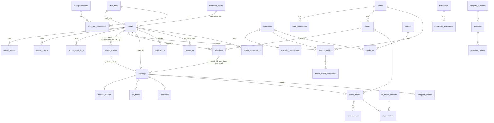

# THIẾT KẾ CƠ SỞ DỮ LIỆU CHUẨN (SCHEMA v2)

> Mục tiêu: thiết kế **một lần**, phủ cả chức năng đang chạy lẫn nhóm sắp làm (hàng đợi, AI, thông báo), để về sau chỉ **thêm code**, không phải sửa schema.
> Đã dựng và kiểm chứng trên MySQL 8.4 (DB `webhealthcare_v2`): 37 bảng nghiệp vụ, 55 khoá ngoại, 19/19 ràng buộc nghiệp vụ được DB chặn đúng khi cố tình vi phạm; toàn bộ code backend đã chuyển sang schema này.
> Nguồn: `backend/src/migrations/20261201000000-baseline-schema.js` (DDL), `backend/src/seeders/` (danh mục), `backend/scripts/migrate-v1-to-v2.js` (chuyển dữ liệu).

---

## 1. Quyết định đã chốt

| Câu hỏi | Quyết định |
|---|---|
| Dữ liệu cũ | Chỉ giữ **danh mục + tài khoản** (user, chuyên khoa, phòng khám, bác sĩ, lịch làm việc, thuốc, cơ sở, gói khám, cẩm nang, câu hỏi khảo sát). Bỏ booking/chat/lịch sử khám/khảo sát đã làm (dữ liệu thử). |
| Chiến lược | **Schema mới + giữ nguyên API**: model Sequelize ánh xạ tên thuộc tính cũ sang cột mới, frontend gần như không phải sửa. |
| Tính năng ngoài đề cương | Giữ hết (gói khám, cơ sở y tế, cẩm nang, khảo sát, chat, PayOS/Casso), thiết kế lại gọn. |

## 2. Quy ước (áp dụng cho mọi bảng)

1. InnoDB, `utf8mb4_unicode_ci`; **snake_case**, tên bảng **số nhiều** (`users`, `bookings`).
2. Khoá chính `BIGINT UNSIGNED AUTO_INCREMENT` (trừ bảng mã `rbac_roles.code`, `rbac_permissions.code`, `doctor_profiles.doctor_id`). Khoá ngoại `<thực thể>_id` **cùng kiểu** với khoá cha.
3. **Mọi quan hệ đều có FOREIGN KEY** (trước đây chỉ 6/33 bảng). Quy tắc xoá: dữ liệu y tế/thanh toán dùng `RESTRICT`; dữ liệu phụ thuộc (bản dịch, token, tin nhắn) dùng `CASCADE`; tham chiếu tuỳ chọn dùng `SET NULL`.
4. Kiểu dữ liệu đúng nghĩa: ngày = `DATE`, thời điểm = `DATETIME`, tiền = `DECIMAL`, cờ = `TINYINT(1)`, trạng thái nội bộ = `ENUM`, danh mục sửa được = `reference_codes`.
5. Ràng buộc nghiệp vụ đặt trong DB: `UNIQUE`, `CHECK`, cột sinh tự động (`GENERATED`). Cột JSON-dạng-TEXT luôn có `CHECK(JSON_VALID)`.
6. Mỗi bảng có `created_at`, `updated_at`. Người dùng và hồ sơ bệnh nhân dùng **xoá mềm** (`deleted_at`) để không mất tham chiếu y tế.
7. Đa ngôn ngữ theo mẫu `<thực thể>` + `<thực thể>_translations` (`UNIQUE(<id>, lang)`, `lang IN ('vi','en')`).
8. Múi giờ: ứng dụng ghi `DATETIME` theo giờ Việt Nam (+07:00, đã cấu hình ở Sequelize).

## 3. Sơ đồ quan hệ (ERD)



## 4. Nhóm bảng

| Nhóm | Bảng | Ghi chú thiết kế |
|---|---|---|
| Danh mục | `reference_codes` | Thay `allcodes`. `code` **duy nhất toàn cục** nên làm được FK thật. Có `numeric_value` (mức giá) và `meta` JSON (khung giờ: `start`/`end`/`shift`). |
| Tài khoản & quyền | `users`, `device_tokens`, `rbac_roles`, `rbac_permissions`, `rbac_role_permissions`, `refresh_tokens`, `access_audit_logs` | `users.role_code → rbac_roles`. `token_version` để thu hồi token. FCM token tách ra `device_tokens` (đa thiết bị). |
| Bệnh nhân | `patient_profiles` | Hồ sơ bản thân và người thân. Cột sinh `self_flag` + `UNIQUE(owner_user_id, self_flag)` ⇒ mỗi tài khoản đúng 1 hồ sơ `SELF`. |
| Tổ chức | `specialties`/`_translations`, `clinics`/`_translations`, `rooms` | Tên, địa chỉ, nội dung giới thiệu nằm trong bảng dịch (bỏ cột `name` thừa ở bảng gốc và bảng `markdowns` đa năng). `rooms` phục vụ TV, cân bằng tải, heatmap. |
| Bác sĩ | `doctor_profiles`, `doctor_profile_translations` | Thay `doctor_infor` (mỗi bác sĩ 1 dòng thay vì 1 dòng/ngôn ngữ) + `doctor_clinic_specialty` (rỗng, bỏ). |
| Đặt lịch | `schedules`, `bookings` | `schedules`: `UNIQUE(doctor_id, work_date, time_code)`, `CHECK(current ≤ max)`. `bookings` tham chiếu slot bằng **FK ghép** `(doctor_id, work_date, time_code)` ⇒ không thể đặt vào khung giờ không tồn tại, và không phải lặp lại dữ liệu. `UNIQUE(patient_id, work_date, time_code, holder_flag)` ⇒ một người không giữ 2 lịch cùng giờ (lịch đã huỷ S4 thì không tính). `hold_expires_at` thay cho tính từ `created_at`. |
| Khám & thanh toán | `medical_records`, `payments` | `medical_records.booking_id` (UNIQUE) nối hồ sơ với lịch hẹn. `payments`: 1 hoá đơn/booking, `gateway_ref UNIQUE` để webhook PayOS/Casso không xử lý trùng. Tiền là `DECIMAL`. |
| Giao tiếp | `messages`, `notifications` | Bỏ cột tên/email người gửi chép lại (suy ra từ `users`). `notifications.dedupe_key UNIQUE` chống gửi trùng. |
| Nội dung | `handbooks`/`_translations`, `facilities`, `packages`, `medicines` | `packages.facility_id` NOT NULL. `medicines.name` UNIQUE (dữ liệu cũ có 25 bản trùng). |
| Khảo sát | `category_questions`, `questions`, `question_options`, `health_assessments` | `health_assessments`: `user_id` (FK) hoặc `guest_key`, có CHECK phải có một trong hai. |
| **Tạo sẵn cho nhóm sắp làm** | `queue_tickets`, `queue_events`, `ai_predictions`, `ml_model_versions`, `symptom_intakes`, `notifications`, `feedbacks` | Máy trạng thái vé (`ENUM` đủ 9 trạng thái), `UNIQUE(room_id, ticket_date, shift, seq)` chống trùng số thứ tự, log sự kiện để audit và làm dữ liệu huấn luyện, bảng so sánh dự đoán AI với thực tế. |

## 5. Ràng buộc DB đang đảm nhiệm (đã test vi phạm → DB chặn)

Đặt vào khung giờ không tồn tại · một bệnh nhân giữ 2 lịch cùng giờ · mã vé trùng · trạng thái ngoài danh mục · xoá bệnh nhân đang có lịch · `max_patients = 0` · `current_patients > max_patients` · trùng lịch bác sĩ · 2 hồ sơ `SELF` · email trùng · vai trò không tồn tại · JSON sai · đánh giá ngoài 1–5 · 2 hoá đơn cho 1 lịch · bản dịch cho bác sĩ không có hồ sơ · ngôn ngữ ngoài `vi/en`.

## 6. Đối chiếu cũ → mới

| Cũ | Mới | Lý do |
|---|---|---|
| `allcodes` | `reference_codes` | Mã duy nhất, có FK, có `numeric_value`/`meta`, sửa nhãn sai (T4 "0:00 PM"). |
| `group`, `groups`, `role`, `group_role` (2 bộ cột) | bỏ; dùng `rbac_*` | Hai hệ RBAC chồng nhau, `groups` rỗng. |
| `doctor_infor` (1 dòng/ngôn ngữ) + `doctor_clinic_specialty` | `doctor_profiles` + `doctor_profile_translations` | Hết nhân đôi dữ liệu theo ngôn ngữ. |
| `markdowns` (đa năng, `handbookId` varchar) | cột `description`/`content_markdown`/`content_html` trong từng bảng `*_translations` | Có FK thật, không còn bảng đa hình. |
| `specialties.name`, `clinics.name/address` (luôn NULL) | bỏ | Cột chết, trùng với bảng dịch. |
| `bookings.id` varchar 8 ký tự, `date` varchar ms | `bookings.id` BIGINT + `code` UNIQUE, `work_date` DATE | Khoá chính chuẩn, truy vấn theo ngày đúng. |
| `schedules.date` varchar | `work_date` DATE, `max_patients`/`current_patients` | Có CHECK sức chứa. |
| `histories` (không nối booking) | `medical_records` (có `booking_id`) | Truy vết đúng lần khám. |
| `cashiers` (`totalPrire` typo, varchar) | `payments` (`amount` DECIMAL, `gateway_ref`) | Hết hack getter/setter, chống webhook trùng. |
| `messages` (lặp tên/email) | `messages` (FK 2 đầu, index cặp) | Chuẩn hoá. |
| `users.fcmToken` | `device_tokens` | Nhiều thiết bị / người. |
| `users.groupId` | bỏ | Thuộc RBAC cũ. |
| `health_assessments.user_id` varchar | `user_id` FK + `guest_key` | Phân biệt người dùng thật và khách. |
| `medicines.price` float | DECIMAL | Tiền không dùng float. |

## 7. Những quyết định có chủ đích (cần biết khi bảo vệ)

1. **`clinics` và `facilities` được giữ riêng.** `clinics` là nơi bác sĩ làm việc (gắn lịch/phòng/hàng đợi), `facilities` là cơ sở đối tác của gói khám. Gộp lại là quyết định sản phẩm, sẽ làm đổi hai API; nếu muốn gộp sau này chỉ cần thêm `facility_id` vào `clinics`.
2. **Ảnh vẫn lưu `LONGBLOB` trong DB** (`users`, `specialties`, `clinics`, `handbooks`) để giữ nguyên cách API trả ảnh. Về sau chuyển sang file/object storage chỉ cần **thêm cột `image_url`**, không đổi cấu trúc.
3. **Cột JSON-dạng-TEXT** (`authors`, `services`, `location`...) giữ kiểu TEXT để code cũ không phải sửa, nhưng có `CHECK(JSON_VALID)`.
4. **Chưa tách `prescription_items`** (đơn thuốc chuẩn hoá): hiện đơn thuốc nằm trong `medical_records.description` (JSON). Thêm bảng này sau là phần *bổ sung*, không phá schema.
5. **Một bác sĩ = một chuyên khoa + một phòng khám** (đúng với dữ liệu hiện tại). Nếu cần nhiều chuyên khoa, thêm bảng nối `doctor_specialties`.
6. `patient_profiles` và `bookings.patient_profile_id` để **NULL được** ở giai đoạn này; khi làm A5 (hồ sơ người thân) code sẽ điền, sau đó có thể siết `NOT NULL`.

## 8. Cách chạy

```bash
cd medical-appointment-system/backend
npm run db:reset            # tạo lại DB (V2_DB_NAME, mặc định webhealthcare_v2) -> migrate -> seed danh mục -> import dữ liệu từ DB cũ
npm run db:migrate          # chỉ chạy migration còn thiếu trên DB_DATABASE_NAME
npm run db:import-v1 -- --dry-run   # (tuỳ chọn) chạy thử import, chỉ in báo cáo
npm run db:check-models     # đối chiếu 30 model Sequelize với schema thật
npm test                    # 20 test phân quyền (không cần DB)
RUN_DB_TESTS=1 npm test     # + 5 test tích hợp trên DB thật (đặt lịch đồng thời, RBAC, refresh token)
npm run smoke:e2e           # (cần server đang chạy, BASE=http://localhost:PORT) 49 kiểm tra đầu-cuối qua HTTP
```
- `.env` trỏ `DB_DATABASE_NAME=webhealthcare_v2`. DB cũ đọc từ `V1_DB_NAME` (mặc định `webhealthcare`), **không bao giờ bị ghi** bởi các lệnh trên.
- Kết quả import: 17 user (bỏ 2 tài khoản trùng email), 10 hồ sơ bác sĩ, 296 lịch làm việc, 5 thuốc (từ 30 bản, 25 bản trùng tên), 5 cơ sở, 8 gói khám, 20 câu hỏi + 75 đáp án.
- Migration/seed cũ nằm ở `src/migrations/_legacy`, `src/seeders/_legacy` (chỉ để tham khảo, không chạy).

## 9. Trạng thái chuyển code sang schema mới: ĐÃ HOÀN TẤT

| Khu vực | Kết quả |
|---|---|
| Model (30) | Viết lại theo v2, giữ tên thuộc tính/alias cũ; `check-models` xanh |
| Auth, RBAC, audit, refresh token, đặt lịch, bệnh nhân, user | Port + 5 test DB tích hợp + e2e |
| Bác sĩ, lịch, đơn thuốc, thanh toán PayOS/Casso | Port; đối chiếu 107 khoá với code cũ; smoke 76 kiểm tra |
| Chuyên khoa, phòng khám, cẩm nang | Port; đối chiếu 99 lời gọi; smoke 64 kiểm tra |
| Gói khám, cơ sở, khảo sát, chat, thuốc | Port; đối chiếu 118 lời gọi; smoke 65 kiểm tra |
| Đầu-cuối trên server thật | 49/49 kiểm tra đạt, dữ liệu tạm được dọn sạch |

**Khác biệt cố ý so với API cũ** (không ảnh hưởng frontend đang dùng):
- `doctorClinic` của chi tiết phòng khám là **mảng** (trước là 1 object nên frontend không bao giờ hiện bác sĩ).
- `booking.id` là **số** (trước là chuỗi hex 8 ký tự); mã vé hiển thị là `booking.code`.
- Tạo/sửa chuyên khoa, phòng khám bắt buộc có `name` (và `lang` cho phòng khám).
- Lỗi nghiệp vụ trả `errCode` khác 0 thay vì ném lỗi (vd. kê đơn khi không có lịch S2).
- Webhook PayOS **từ chối** khi chữ ký sai (trước đây vẫn xử lý bằng dữ liệu chưa xác thực), kiểm tra số tiền ≥ hoá đơn, và idempotent theo `gateway_ref`.
- Các API đọc dữ liệu bác sĩ không còn trả `password`, `deletedAt`, `tokenVersion`, `lastLoginAt`, `isActive`.

**Dữ liệu thay đổi khi import** (do ràng buộc mới): thuốc trùng tên chỉ giữ 1 bản; tên có khoảng trắng thừa được trim; bác sĩ từng có giá/phòng khám khác nhau giữa bản vi và en nay dùng giá trị bản vi; nhãn giờ "0:00 PM" sửa thành "12:00 PM".

**Còn tồn tại có chủ đích:** `FACILITY_TO_DOCTORS` trong `getPackageBookingSlots` vẫn hard-code id bác sĩ; kết quả khảo sát của khách (`guest_key`) không đọc lại được qua API nữa vì không gắn tài khoản.
