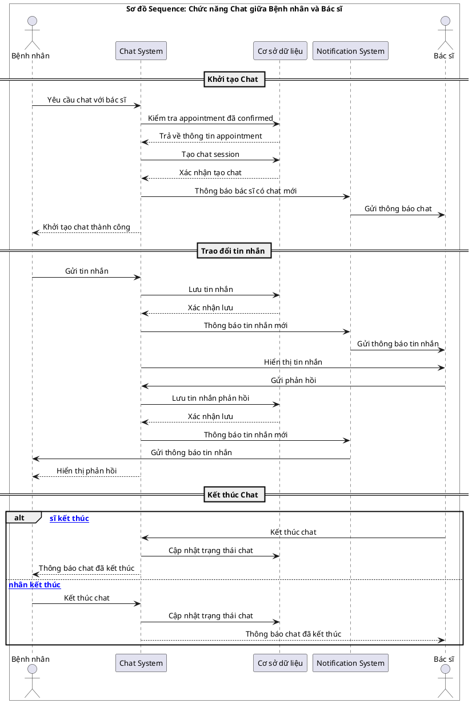
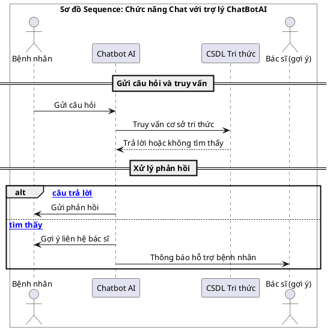
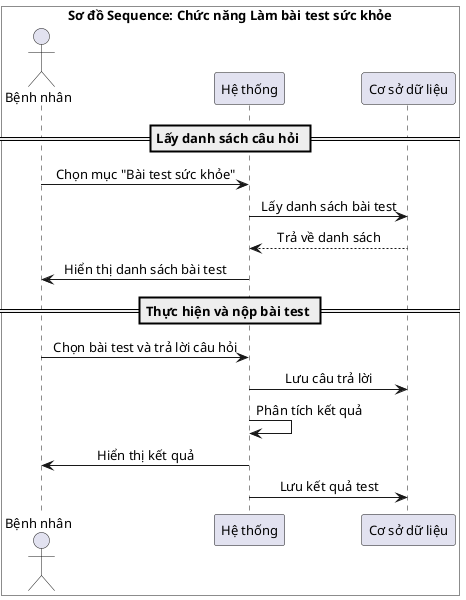
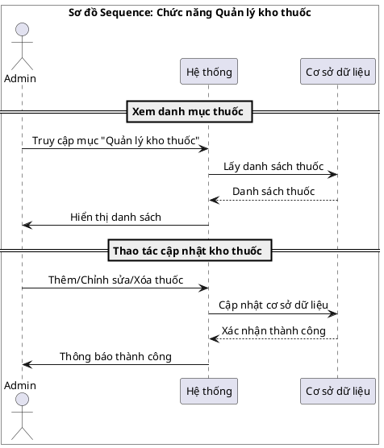

# 🔄 Trọn bộ Sơ đồ tuần tự chuẩn mẫu báo cáo (UML Sequence Diagrams)

Tài liệu này cung cấp mã nguồn **PlantUML** cho các sơ đồ tuần tự được thiết kế **chính xác 100% theo đúng định dạng mẫu ảnh của bạn**:
- Sử dụng cấu trúc `box "<Tiêu đề sơ đồ>" #White ... end box` bao trùm toàn bộ các thành phần actor/participant để tạo **đường viền lớn bao quanh toàn bộ sơ đồ** kèm **tiêu đề in đậm ở giữa phía trên**.
- Phân đoạn các mốc giai đoạn bằng thanh ngăn cách UML (`== Tên giai đoạn ==`).
- Tương thích tuyệt đối 100% với **draw.io / app.diagrams.net** (không báo bất kỳ lỗi nào).

---

## 1. Hình 15: Sơ đồ tuần tự Chat giữa bệnh nhân và bác sĩ

---

## 2. Hình 16: Sơ đồ tuần tự Chat với trợ lý ChatBotAI

---

## 3. Hình 17: Sơ đồ tuần tự Làm bài test sức khỏe

---

## 4. Hình 18: Sơ đồ tuần tự Quản lý kho thuốc

---

## 🛠️ Hướng dẫn dán vào draw.io (app.diagrams.net):
1. Mở [app.diagrams.net](https://app.diagrams.net).
2. Vào: **Arrange** ➡️ **Insert** ➡️ **Advanced** ➡️ **PlantUML...**
3. Sao chép và dán mã ở trên vào.
4. Bấm **Insert**. Bạn sẽ nhận được sơ đồ có **khung viền chữ nhật bao trọn toàn bộ sơ đồ** từ trên xuống dưới, có tiêu đề nằm ở đầu, các thanh chia giai đoạn `== Tên giai đoạn ==` và khung `alt` giống hệt 100% như hình mẫu của bạn!
