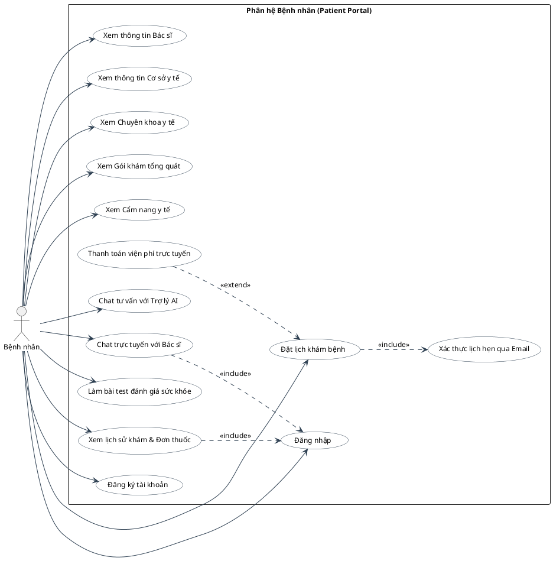
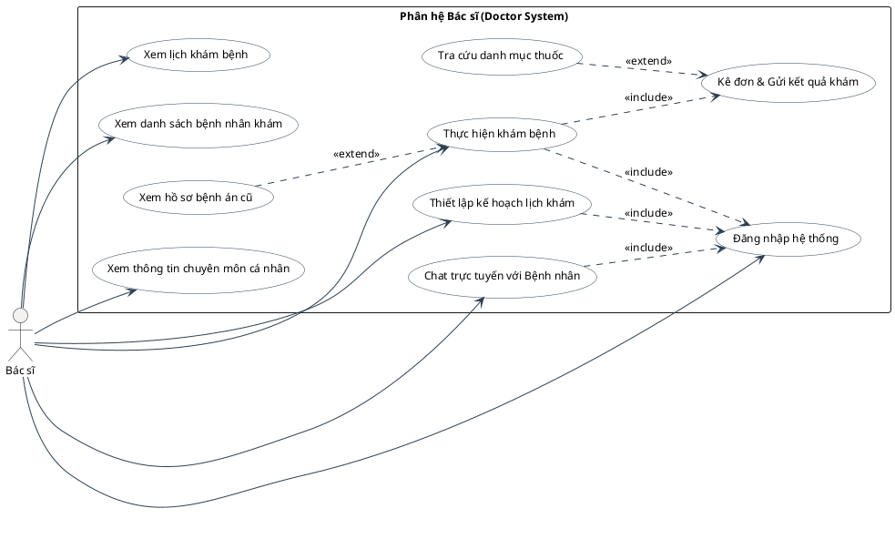

# 🎯 Tuyển tập Sơ đồ Use Case Hệ thống Y tế (UML Use Case Diagrams)

Tài liệu này phân tích, đánh giá tính chuẩn xác theo UML và mã nguồn thực tế, đồng thời cung cấp mã nguồn **PlantUML** hoàn chỉnh cho các sơ đồ Use Case của hệ thống:
1. **Sơ đồ Use Case của Bệnh nhân**
2. **Sơ đồ Use Case của Bác sĩ**

---

# PHẦN 1: SƠ ĐỒ USE CASE CỦA BỆNH NHÂN

## 🔍 I. Nhận xét sơ đồ Use Case Bệnh nhân (ảnh cũ)
1. **Sai chiều mũi tên `<<extend>>`**: Trong ảnh, mũi tên đi từ `Nhận đơn thuốc/kết quả` trỏ sang `Thanh toán chi phí online`. Quy tắc chuẩn UML: Mũi tên `<<extend>>` **bắt buộc phải trỏ từ Use Case mở rộng (Extension) VỀ Use Case cơ sở (Base)**.
2. **Lỗi phân rã chức năng (Functional Decomposition) ở `Đặt lịch khám`**: Tách `Đặt lịch khám` ra thành `Chọn bác sĩ`, `Chọn khung giờ`, `Xác nhận lịch khám` rồi nối `<<include>>` là sai bản chất của Use Case (vốn phải là mục tiêu trọn vẹn).
3. **Use Case thụ động**: `Nhận đơn thuốc/kết quả` là hành động bị động, nên chuẩn hóa thành `Xem lịch sử khám & Đơn thuốc`.
4. **Gộp `Đăng nhập/Đăng kí` trong một hình Oval**: Cần tách riêng thành 2 Use Case độc lập.
5. **Thiếu các tính năng cốt lõi**: Thiếu *Chatbot AI (RAG Gemini)*, *Bài test đánh giá sức khỏe*, *Gói khám tổng quát* và *Cẩm nang y tế*.

## 💻 Mã PlantUML Use Case Bệnh nhân

---

# PHẦN 2: SƠ ĐỒ USE CASE CỦA BÁC SĨ

## 🔍 I. Nhận xét sơ đồ Use Case Bác sĩ (ảnh của bạn)

Sơ đồ cũ trong ảnh có **4 lỗi sai rất nặng về cả chuẩn UML lẫn logic nghiệp vụ thực tế**:

### 1. Lỗi nghiệp vụ: Bác sĩ KHÔNG có Use Case "Đăng ký"
- Trong ảnh vẽ: `Đăng nhập/Đăng ký`.
- **Thực tế hệ thống**: Bác sĩ là nhân sự y tế chất lượng cao, **bác sĩ KHÔNG BAO GIỜ tự đăng ký tài khoản tự do trên trang web**. Tài khoản của Bác sĩ bắt buộc phải do **Quản trị viên (Admin) tạo trong hệ thống** và cấp chức danh (`positionId`: Bác sĩ CK1, Giáo sư,...), gán chuyên khoa (`specialtyId`), phòng khám (`clinicId`). Việc để use case "Đăng ký" cho Bác sĩ là sai hoàn toàn logic nghiệp vụ thực tế. Bác sĩ chỉ có **Đăng nhập hệ thống**.

### 2. Lỗi sai chuẩn UML: Chiều mũi tên `<<extend>>` bị ngược hoàn toàn
Trong ảnh có 2 mũi tên `<<extend>>` và **cả 2 đều bị vẽ ngược chiều**:
- `Chat với bệnh nhân` --<<extend>>--> `Tư vấn trực tuyến`: Mũi tên lại trỏ sang `Tư vấn trực tuyến`?! Thực chất 2 use case này là một, và chiều của `<<extend>>` trong UML luôn là: `Use Case mở rộng ..> Use Case cơ sở`.
- `Khám bệnh` --<<extend>>--> `Xem hồ sơ bệnh án`: Mũi tên lại trỏ từ `Khám bệnh` sang `Xem hồ sơ bệnh án`?! Đúng chuẩn UML phải là việc xem lại hồ sơ bệnh án cũ mở rộng hỗ trợ cho quá trình khám bệnh: `Xem hồ sơ bệnh án cũ` ..> `Khám bệnh` : `<<extend>>`.

### 3. Lỗi phân rã chức năng (Functional Decomposition) ở `Khám bệnh`:
- Tách `Khám bệnh` thành 3 use case con: `Ghi đơn thuốc`, `Ghi kết quả khám`, `Gửi đơn thuốc và chi phí` rồi nối `<<include>>` là bị vụn vặt và lặp lại thao tác.
- Trong mã nguồn thực tế ([`doctorServices.js:sendRemedyService`](file:///d:/XuanDuc/CV/medical-appointment-system/backend/src/services/doctorServices.js#L705)), khi khám xong bác sĩ thực hiện một hành động trọn vẹn: **`Kê đơn & Gửi kết quả khám (Send Remedy)`** (ghi chẩn đoán, đính kèm đơn thuốc/hóa đơn gửi thẳng qua email bệnh nhân).

### 4. Lỗi sai chính tả và thuật ngữ:
- `Cập nhập lịch trống`: Sai chính tả tiếng Việt ("Cập nhập" -> phải là **"Thiết lập kế hoạch lịch khám"** hoặc **"Cập nhật lịch khám"**).
- `Xác nhận lịch hẹn`: Lịch hẹn do Bệnh nhân tự kích hoạt qua link Email token. Bác sĩ chỉ cần **Xem danh sách bệnh nhân đã được xác nhận (Status: S2) để tiến hành khám**.
- **Tính năng bị thiếu**: Thiếu Use Case **Tra cứu danh mục kho thuốc** (khi kê đơn cho bệnh nhân).

---

## 💻 II. Mã PlantUML Sơ đồ Use Case Bác sĩ chuẩn hóa 100%

*Sơ đồ nằm gọn trong **1 khung viền chữ nhật bao quanh toàn hệ thống**, đúng chiều mũi tên `<<include>>` và `<<extend>>`, chuẩn font Times New Roman, sẵn sàng dán trực tiếp vào draw.io:*

---

## 🛠️ Hướng dẫn dán vào draw.io (app.diagrams.net):
1. Mở [app.diagrams.net](https://app.diagrams.net).
2. Vào: **Arrange** ➡️ **Insert** ➡️ **Advanced** ➡️ **PlantUML...**
3. Sao chép và dán mã ở trên vào.
4. Bấm **Insert** để nhận ngay sơ đồ Use Case chuẩn chỉnh, không có lỗi, sẵn sàng đưa vào báo cáo đồ án tốt nghiệp.
